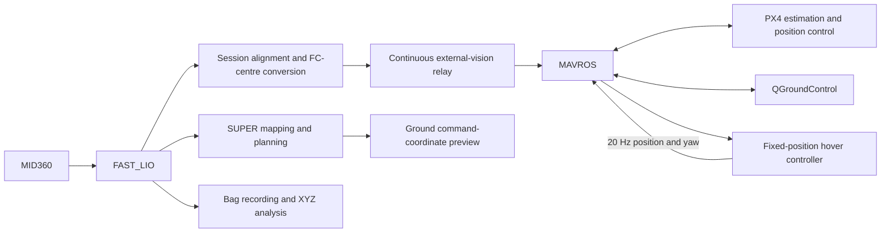

# Demo_HKU_open-day_SUPER

An indoor autonomous flight project for the HKU Open Day demonstration, integrating Livox MID360, FAST_LIO, SUPER, MAVROS, and PX4.

**Status — October 10, 2026:** the complete fixed-position flight sequence has succeeded on the aircraft: **OFFBOARD entry, automatic arming, takeoff, a hover test configured for 1 m above the floor and a 6-second hold, followed by automatic landing**. This establishes the first flight-control milestone. Planner-driven trajectory flight and obstacle avoidance are the next integration stage.

## Project progress

| Component | Status | Result |
| --- | --- | --- |
| MID360 → FAST_LIO | Operational | Approximately 10 Hz odometry and registered point clouds |
| Localization timing | Fixed and deployed | IMU Best Effort subscription removed the observed backlog; recent ground pose ages were approximately 20–35 ms |
| FAST_LIO → PX4 external vision | Operational | Position, height, and yaw fusion through MAVROS; fresh `vehicle_visual_odometry` and valid local position/velocity |
| Fixed-position flight | **Successful on aircraft** | Complete automatic takeoff, hover, and landing sequence |
| SUPER mapping and planning | Ground integration complete | Occupancy map, trajectory generation, replanning, and converted command preview |
| SUPER → flight trajectory execution | Pending | Ground preview is separate from the completed hover controller |
| Remote operation | Operational | Mac → NoMachine → onboard Ubuntu desktop, including QGC and terminals |
| Loop recording and XYZ analysis | Tools ready | Bag export, point-cloud inspection, timing gaps, and return-to-marker metrics |
| Venue limits and 2 m/s demonstration | Pending | Surveyed boundaries, clearance margins, and staged flight validation |

The successful flight is a functional milestone. Height error, horizontal drift, timing distributions, and repeatability will be quantified from flight logs and independent measurements in the next test campaign.

- [Current progress and flight milestone](docs/PROGRESS_2026-10-10.md)
- [Complete flight workflow: terminals 1–11 and reboot recovery](docs/FIRST_HOVER_2026-10-09.md)
- [Next development and validation steps](docs/NEXT_STEPS.md)
- [Three-terminal bag recording and XYZ analysis](docs/BAG_XYZ_2026-10-09.md)
- [Remote desktop and AX900 recovery](docs/REMOTE_RECOVERY_2026-10-09.md)

## System architecture



The onboard computer runs the complete ROS stack and connects to the flight controller over USB. Remote desktop access uses Wi-Fi; the USB link stays onboard during flight. QGC receives the MAVROS UDP forwarding stream rather than opening the flight-controller serial port directly.

The hover controller currently uses 10 Hz localization and sends 20 Hz position/yaw setpoints. Increasing sensor frequency is a separate optimization; duplicate samples and rewritten timestamps are not used to simulate a higher measurement rate.

## Repository structure

```text
scripts/
  localization/   Pose conversion, alignment, and external-vision relays
  flight/         Hover control, references, and parameter helpers
  planning/       SUPER command preview and diagnostic goals
  analysis/       Bag export and message-timing diagnostics
  maintenance/    Source patches, generators, and deployment helper
  layout.json     Source-to-aircraft filename mapping
docs/             Runbooks, progress, and historical checkpoints
configs/          Recorded configuration snapshots
patches/          FAST_LIO source patches
system/           AX900 startup configuration
tests/            Offline and isolated ROS checks
data/             Data storage conventions
```

Three complete standalone files remain at the root for stable download URLs: `first_hover_terminal.py`, `odom_age_check.py`, and `update_preview_alignment.py`.

The [script index](scripts/README.md) explains the categories and deployment rules. The [documentation index](docs/README.md) links the operational runbooks and historical checkpoints.

## Aircraft deployment

The aircraft uses Ubuntu 22.04, ROS2 Humble, and zsh. Livox, FAST_LIO, SUPER, and MAVROS workspaces must already be installed; this repository contains integration scripts and records rather than a complete bundled ROS distribution.

From the repository root on the onboard computer:

```bash
python3 scripts/maintenance/install_scripts.py
```

This installs missing scripts into `~/Downloads` and preserves existing files, including the active session alignment. To update changed files, first land, disarm, and stop affected processes, then use:

```bash
python3 scripts/maintenance/install_scripts.py --overwrite
```

Changed files are backed up before replacement. Localization or alignment updates require a fresh stationary pairing before restoring the vision relay. The deployment helper does not start nodes or change PX4 parameters.

Aircraft commands retain the flat `~/Downloads/script_name.py` paths even though repository sources are categorized. The standalone hover controller can also be downloaded separately using the [flight runbook](docs/FIRST_HOVER_2026-10-09.md#download-and-install).

## Reboot recovery and flight entry point

Compiled FAST_LIO fixes persist across a normal reboot. Restore the processes and measure a new session alignment; recompilation is only needed when changing the installed source.

| Terminal | Role | During fixed-position flight |
| --- | --- | --- |
| 1 | MID360 driver | Running |
| 2 | FAST_LIO | Running |
| 3 | MAVROS: USB and QGC UDP forwarding | Running |
| 4 | FC-centre attitude diagnostics | Running |
| 5 | Parameters, alignment, start/land services | Command window |
| 6 | Aligned pose preview | Running |
| 7 | Continuous external-vision relay | Running, including after arming |
| 8 | QGroundControl | Running |
| 9 | SUPER ground diagnostic planner | Stopped for hover test |
| 10 | Ground planner-command preview | Stopped for hover test |
| 11 | Standalone hover controller | Running |

The [complete flight workflow](docs/FIRST_HOVER_2026-10-09.md) includes every startup command, fusion checks, RC/Position preflight, and recovery steps. After these checks, terminal 11 uses the tested profile:

```bash
source /opt/ros/humble/setup.zsh
python3 ~/Downloads/first_hover_terminal.py --execute --hover-height 1.0 --hold-seconds 6.0
```

The process waits for READY and an explicit start request. In terminal 5:

```bash
ros2 service call /first_hover/start std_srvs/srv/Trigger '{}'
```

This request starts one automatic flight. The controller first streams ground-position setpoints for approximately 2 seconds, confirms OFFBOARD, then requests arming. XY and yaw remain fixed. After the height target is reached and the hold completes, PX4 performs AUTO.LAND. A new flight requires a new controller instance after landing and disarming.

The FC centre is approximately 8.5 cm above the floor at rest. A 1 m floor-relative target therefore uses `z_ground + 0.915 m`. Early landing is available through `/first_hover/land`; manual mode takeover takes priority over controller mode requests.

## Configuration and coordinate conventions

| Parameter | Recorded test configuration |
| --- | --- |
| `EKF2_EV_CTRL` | `11`: horizontal position, height, and yaw; no external velocity |
| `EKF2_HGT_REF` | `3`: vision height reference |
| `EKF2_BARO_CTRL` | `1` |
| `EKF2_EV_DELAY` | `0.0` |
| `EKF2_EV_POS_X/Y/Z` | `0.0`: incoming poses already refer to the FC centre |
| `EKF2_EV_QMIN` | `0` |
| `MPC_XY_VEL_ALL`, `MPC_Z_VEL_ALL` | `-1.0` |
| `MPC_XY_VEL_MAX` | `0.5 m/s` |
| `MPC_Z_VEL_MAX_UP`, `MPC_Z_VEL_MAX_DN` | `0.5 m/s` |
| `COM_OF_LOSS_T` | `0.5 s` |
| `COM_OBL_RC_ACT` | `4`: Land in the recorded firmware |

FAST_LIO publishes `camera_init → body` at the LIO IMU origin. Conversion applies the nominal mounting rotation, lever arm, session world rotation, and fixed translation origin to produce FC-centre ENU poses. MAVROS handles ENU/NED conversion.

The nominal LiDAR mounting has approximately +45° yaw relative to the aircraft and a 10 cm vertical offset above the FC. The recorded internal IMU–LiDAR configuration uses `extrinsic_T=[-0.011,-0.02329,0.04412]` and identity rotation. A paired world quaternion is a session alignment, not an independent mechanical extrinsic calibration.

SUPER's `world` coordinates currently follow the numerical LIO world. The ground command preview converts these into the aligned FC frame. Trajectory flags `1` and `2` represent regular and backup trajectories in the pinned publisher; ground preview success does not implement trajectory flight.

## Development checks

Pure repository checks run from the checkout. ROS graph tests require Humble, MAVROS message/service definitions, and SUPER `PositionCommand`; use an environment and ROS domain isolated from the aircraft.

```bash
source /opt/ros/humble/setup.bash
export PYTHONPATH="$PWD:$PWD/scripts/localization:$PWD/scripts/flight:$PWD/scripts/planning:$PWD/scripts/analysis:$PWD/scripts/maintenance${PYTHONPATH:+:$PYTHONPATH}"
export ROS_DOMAIN_ID=180
export ROS_LOCALHOST_ONLY=1
python3 tests/test_repository_layout.py
python3 tests/test_hover_reference.py
python3 tests/test_bag_to_xyz.py
python3 scripts/maintenance/build_first_hover_terminal.py --check
python3 tests/test_aligned_pose_preview.py
python3 tests/test_control_bridge_preview.py
python3 tests/test_flight_pose_cov_transport.py
python3 tests/test_first_hover_control.py
FIRST_HOVER_TEST_MODULE=first_hover_terminal python3 tests/test_first_hover_control.py
```

The directory/deployment, reference, and bag suites contain 13 passing unit tests. Isolated ROS checks cover pose/covariance conversion, planning preview, continuous vision forwarding, and one-shot hover control. The generated standalone controller matches the canonical implementation. Physical takeoff/hover/landing success is recorded separately from these software checks.

## Versions and references

| Component | Recorded version |
| --- | --- |
| Ubuntu / ROS | 22.04 / Humble |
| Livox driver | `livox_ros_driver2` 1.2.7 |
| FAST_LIO | ROS2, `a4743b095409588842a5b30ddfa27e29d2f99164` |
| SUPER | `2ad3419c127a617c6d7df6925e81a14175a9c096` |
| MAVROS | 2.14.0 |
| PX4 | HKUST_NXT_DUAL, 1.17.0, `d6f12ad1c4f70ad3230afd7d86e971421e02fef4` |

[SUPER](https://github.com/hku-mars/SUPER) · [FAST_LIO ROS2](https://github.com/hku-mars/FAST_LIO/tree/ROS2) · [Livox ROS Driver 2](https://github.com/Livox-SDK/livox_ros_driver2) · [MAVROS](https://github.com/mavlink/mavros/tree/2.14.0) · [PX4 external position estimation](https://docs.px4.io/main/en/ros/external_position_estimation) · [PX4 Offboard](https://docs.px4.io/main/en/flight_modes/offboard)
