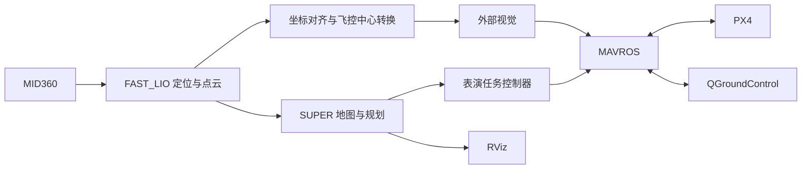

# HKU Open Day · SUPER 无人机演示

使用 **Livox MID360 → FAST_LIO → SUPER → MAVROS → PX4** 完成室内定位、轨迹规划和往返避障演示。

**[安装与开机快速开始](docs/QUICK_START_ZH.md)** · **[1.8 m 实飞操作](docs/PHYSICAL_FLIGHT_ZH.md)** · [English startup guide](docs/REBOOT_QUICK_START.md) · [全部文档](docs/README.md)

## 从这里开始

| 目的 | 入口 |
|---|---|
| 首次安装或更新配套脚本 | [完整安装器与一次性编译](docs/QUICK_START_ZH.md#第一次更新整套安装一次) |
| 开机后自动跑地面演习 | 下方命令；无需手动复制四元数 |
| 在实验室执行实际表演任务 | [实测配置、准备、起飞和降落](docs/PHYSICAL_FLIGHT_ZH.md) |
| 查看报告或排查不动、启动失败 | [结果与恢复](docs/QUICK_START_ZH.md#看结果和保存报告) |
| 理解系统、配置或参与开发 | [文档导航](docs/README.md) |

## 每次开机后的地面演习

已安装配套脚本及 ROS 工作空间后，在机载 Ubuntu 打开一个终端。真实飞机静止、未解锁：

```bash
python3 ~/Downloads/super_demo_test.py \
  --restart --fixed-lio-extrinsics \
  --fixture-geometry --motion-policy observe --fast-start
```

自动打开 QGC，启动定位与视觉链路，测量本次对齐四元数、捕获地图，再打开 RViz 显示真实 SUPER 规划和虚拟飞机。点云显示大小为 5 像素。正常重启无需重新下载或编译。

结束时输出 `RESULT: SUCCESS` 或 `RESULT: FAIL`，报告保存在 `~/Downloads/super_demo_tests/<时间戳>/`。地面演习使用真实地图和规划器、虚拟飞机反馈；它不是 PX4 动力学仿真，也不会让真实飞机起飞。

## 表演任务

| 项目 | 设置 |
|---|---|
| 实飞目标高度 | 飞控中心离地 **1.8 m**，实飞命令显式指定 |
| 地面虚拟目标高度 | 0.5 m |
| 航线 | 前进 4.5 m → 返回原悬停点，共 **5 次往返** |
| 最后阶段 | 悬停 6 秒 → 降落 → 确认落地及未解锁 |
| 规划目标速度 / 加速度 | 2 m/s / 1 m/s² |
| 轨迹接受上限 | 4 m/s / 2 m/s² |
| 场地外边界 | 前后 5.8 m × 左右 2.8 m × 高 2.8 m |

SUPER 持续重规划，可沿曲线避障；返回时重新规划回原悬停点，保持起飞航向。1.8 m 是起飞和悬停目标高度，三维避障轨迹可以改变高度，不是整段固定 Z 平面。没有额外的整段任务或首条轨迹等待截止时间。

`observe` 模式记录运动超限；位置边界、数据新鲜度和轨迹连续性检查仍然生效。实飞使用实测机体外形和起飞位置；虚拟演习的 `--fixture-geometry` 不用于实飞。

## 系统关系



机载电脑通过 USB 连接飞控，通过 Wi-Fi 提供远程桌面。QGC 使用 MAVROS 的 UDP 转发。机载环境为 Ubuntu 22.04、ROS 2 Humble；此仓库包含集成脚本、配置和补丁，Livox、FAST_LIO、SUPER、MAVROS 工作空间需要预先安装。

## 验证范围

完整五次往返已在真实点云、真实 SUPER 和虚拟飞机反馈下跑通。较早的实际定点起飞、悬停和降落已有现场记录；**1.8 m 完整表演实飞尚待现场验证**。当前已知问题和证据集中在[验证说明](docs/VALIDATION.md)，历史调试记录不作为当前启动步骤。

## 仓库结构

| 目录 | 内容 |
|---|---|
| `scripts/maintenance/` | 安装、启动、自动测试和配置生成 |
| `scripts/localization/` | 坐标对齐与外部视觉 |
| `scripts/planning/`、`scripts/flight/` | 规划接续、场地约束和任务控制 |
| `scripts/simulation/` | 地面虚拟演习 |
| `configs/` | 任务、RViz 和发布清单 |
| `docs/` | 使用指南和技术参考 |
| `tests/`、`data/` | 回归检查与验证数据 |

部署后仍使用 `~/Downloads/<脚本名>` 的路径。详见[脚本目录](scripts/README.md)与[开发检查](docs/DEVELOPMENT.md)。

[SUPER](https://github.com/hku-mars/SUPER) · [FAST_LIO](https://github.com/hku-mars/FAST_LIO/tree/ROS2) · [Livox Driver](https://github.com/Livox-SDK/livox_ros_driver2) · [MAVROS](https://github.com/mavlink/mavros) · [PX4](https://docs.px4.io/)
