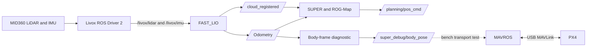

# Demo_HKU_open-day_SUPER

Deployment and integration notes for the SUPER UAV demonstration used at the HKU Open Day.

Last updated: September 29, 2026

Current status: The MID360 → FAST_LIO → SUPER perception and planning pipeline is operational. MAVROS is connected to PX4, the nominal LiDAR-to-body rotation has passed a bench rotation test, and ROS-side external-pose transport to MAVROS has been verified. PX4 external-vision fusion remains disabled because MAVLink time synchronization and the external-pose update rate are not yet suitable for flight.

> `FOLLOW_TRAJ` is an internal SUPER planner state. It does not mean that the real UAV followed the trajectory.

---

## 1. Quick Start: LiDAR and QGroundControl

These commands are intended for Ubuntu 22.04 with ROS 2 Humble and zsh.

Run every command separately. Do not copy terminal prompts, HTML line-break tags, or trailing backslashes.

### 1.1 MID360 for FAST_LIO

FAST_LIO requires the Livox CustomMsg output.

```zsh
source /opt/ros/humble/setup.zsh
source ~/ws_livox/install/setup.zsh
ros2 launch livox_ros_driver2 msg_MID360_launch.py
```

Keep this terminal running.

Verified output:

```text
/livox/lidar: approximately 10 Hz
/livox/imu: approximately 200 Hz
/livox/lidar type: livox_ros_driver2/msg/CustomMsg
```

A successful driver startup includes a message similar to:

```text
livox/lidar publish use livox custom format
```

### 1.2 QGroundControl

Start QGroundControl with:

```zsh
~/Downloads/QGroundControl-x86_64.AppImage
```

If the AppImage does not have execution permission:

```zsh
chmod +x ~/Downloads/QGroundControl-x86_64.AppImage
```

Connection notes:

- QGroundControl can connect directly to the flight controller through USB for standalone inspection.
- Close QGroundControl before MAVROS opens `/dev/ttyACM0`.
- MAVROS is configured to forward MAVLink to UDP port `14550`.
- The MAVROS-to-QGroundControl UDP connection still requires final verification.

### 1.3 MID360 raw PointCloud2 inspection

Use this mode only when viewing the raw PointCloud2 output in RViz:

```zsh
source /opt/ros/humble/setup.zsh
source ~/ws_livox/install/setup.zsh
ros2 launch livox_ros_driver2 rviz_MID360_launch.py
```

Do not run `rviz_MID360_launch.py` and `msg_MID360_launch.py` at the same time.

Use `msg_MID360_launch.py` for FAST_LIO.

---

## 2. Current Progress

| Module | Status | Verification |
|---|---|---|
| SUPER build and `click_demo` | Completed | The simulator moved after correcting the backup-trajectory parameter |
| MID360 network | Completed | Ubuntu and MID360 communicate over `192.168.50.0/24` |
| Livox ROS Driver 2 | Completed | CustomMsg point cloud at approximately 10 Hz and IMU at approximately 200 Hz |
| FAST_LIO ROS 2 build | Completed | Official ROS2 branch and ikd-Tree submodule compiled successfully |
| FAST_LIO initialization | Completed | `IMU Initial Done` and map k-d tree initialization observed |
| FAST_LIO odometry | Completed | `/Odometry` publishes at approximately 10 Hz |
| Registered point cloud | Completed | `/cloud_registered` publishes at approximately 10 Hz |
| FAST_LIO frame consistency | Completed | Odometry and registered clouds use `camera_init` |
| SUPER real-sensor input | Completed | SUPER receives FAST_LIO odometry and point-cloud data |
| ROG-Map | Completed | Occupancy voxels are visible in RViz |
| Planning on real point clouds | Basic verification completed | `GenerateExpTrajectory SUCCESS`, `FOLLOW_TRAJ`, and `ReplanOnce succeed` observed |
| SUPER command output | Completed | `/planning/pos_cmd` publishes at approximately 99.5–100 Hz |
| QGroundControl direct USB connection | Completed | Firmware and MAVLink status read successfully |
| MAVROS connection to PX4 | Completed | `/mavros/state` reports `connected: true` |
| PX4 local pose | Inspected | Local attitude and position topics are available |
| PX4 horizontal estimator status | Not ready | Horizontal-position flags were false and constant-position mode was active |
| LiDAR-to-body nominal transform | Bench validation completed | FAST_LIO and PX4 yaw changes agreed within approximately 1.33° |
| ROS-to-MAVROS pose transport | Verified | `/super_debug/body_pose` was relayed to `/mavros/vision_pose/pose` |
| PX4 external-vision fusion | Disabled | `EKF2_EV_CTRL = 0` |
| MAVLink time synchronization | Blocked | Round-trip time was approximately 8.3–9.2 seconds |
| External-pose update rate | Not flight-ready | FAST_LIO pose is approximately 10 Hz and its odometry twist is zero |
| SUPER-to-PX4 command bridge | Not implemented | SUPER commands are not converted into PX4 setpoints |
| Offboard closed-loop control | Not verified | No real closed-loop position test has been completed |
| Autonomous real flight | Not verified | No autonomous real flight has been completed |

---

## 3. Environment and Versions

| Item | Current value |
|---|---|
| Operating system | Ubuntu 22.04 |
| ROS | ROS 2 Humble |
| Shell | zsh |
| Livox ROS Driver 2 | 1.2.7 |
| SUPER commit | `2ad3419c127a617c6d7df6925e81a14175a9c096` |
| FAST_LIO branch | `ROS2` |
| FAST_LIO commit | `a4743b095409588842a5b30ddfa27e29d2f99164` |
| ikd-Tree commit | `e2e3f4e9d3b95a9e66b1ba83dc98d4a05ed8a3c4` |
| MAVROS | 2.14.0 |
| mavros-extras | 2.14.0 |
| Flight-controller architecture | `HKUST_NXT_DUAL` |
| Flight-controller MCU | STM32H7 |
| PX4 firmware | Release 1.17.0 custom board build |
| PX4 git hash | `d6f12ad1c4f70ad3230afd7d86e971421e02fef4` |
| PX4 build time | May 13, 2026, 18:40:15 |
| Flight-controller connection | USB |
| Ubuntu serial device | `/dev/ttyACM0` |
| PX4 board rotation | `SENS_BOARD_ROT = 8` |
| uXRCE-DDS configuration | `UXRCE_DDS_CFG = 0` |
| uXRCE-DDS client | Present but not running |
| MAVROS transport | USB MAVLink at 2,000,000 baud |

Workspace paths:

```text
~/ws_livox/                         Livox workspace
~/fastlio_ws/                       FAST_LIO workspace
~/fastlio_ws/src/FAST_LIO/          FAST_LIO source
~/super_ws/                         SUPER workspace
~/super_ws/src/SUPER/               SUPER source
~/fastlio_ws/mid360_super.rviz      Saved RViz configuration
~/Downloads/fastlio_body_debug.py   Body-frame diagnostic script
~/Downloads/QGroundControl-x86_64.AppImage
```

---

## 4. Current Data Pipeline



The path from `/planning/pos_cmd` to PX4 has not been implemented.

The external-pose path is currently a bench transport test. PX4 fusion remains disabled.

---

## 5. MID360 Network Configuration

### 5.1 Current settings

| Item | Value |
|---|---|
| Ubuntu Ethernet interface | `enp4s0` |
| Ubuntu IP | `192.168.50.125/24` |
| MID360 IP | `192.168.50.163` |

Check the network interfaces:

```zsh
ip -br addr
```

Check communication with the LiDAR:

```zsh
ping 192.168.50.163
```

The MID360 interface and the Ubuntu Ethernet interface must be in the same subnet.

---

## 6. FAST_LIO Installation

Create the workspace:

```zsh
mkdir -p ~/fastlio_ws/src
```

Clone the official ROS 2 branch:

```zsh
git clone --branch ROS2 --single-branch --recursive https://github.com/hku-mars/FAST_LIO.git ~/fastlio_ws/src/FAST_LIO
```

Verify the source commit:

```zsh
git -C ~/fastlio_ws/src/FAST_LIO rev-parse HEAD
```

Expected commit:

```text
a4743b095409588842a5b30ddfa27e29d2f99164
```

Verify the submodule:

```zsh
git -C ~/fastlio_ws/src/FAST_LIO submodule status
```

Expected ikd-Tree commit:

```text
e2e3f4e9d3b95a9e66b1ba83dc98d4a05ed8a3c4
```

Install dependencies:

```zsh
source /opt/ros/humble/setup.zsh
rosdep install --from-paths ~/fastlio_ws/src --ignore-src -r -y
```

Build:

```zsh
cd ~/fastlio_ws
source /opt/ros/humble/setup.zsh
source ~/ws_livox/install/setup.zsh
colcon build --symlink-install
```

The Boost placeholder and CMake policy messages observed during compilation are warnings. The build completed successfully.

### 6.1 FAST_LIO MID360 configuration

Configuration file:

```text
~/fastlio_ws/src/FAST_LIO/config/mid360.yaml
```

Required topics:

```yaml
common:
  lid_topic: "/livox/lidar"
  imu_topic: "/livox/imu"
  time_sync_en: false
```

Preprocessing configuration:

```yaml
preprocess:
  lidar_type: 1
  scan_line: 4
  blind: 0.5
  timestamp_unit: 3
  scan_rate: 10
```

Current nominal extrinsics:

```yaml
mapping:
  extrinsic_est_en: true
  extrinsic_T: [ -0.011, -0.02329, 0.04412 ]
  extrinsic_R: [ 1.0, 0.0, 0.0,
                 0.0, 1.0, 0.0,
                 0.0, 0.0, 1.0 ]
```

PCD saving is disabled:

```yaml
pcd_save:
  pcd_save_en: false
  interval: -1
```

Because `extrinsic_est_en` is enabled, the values in the configuration are initial estimates. They are not necessarily the final live LiDAR–IMU extrinsics.

---

## 7. SUPER Real-Sensor Configuration

Configuration file:

```text
~/super_ws/src/SUPER/super_planner/config/mid360_real_ros2.yaml
```

Required input topics:

```yaml
cloud_topic: "/cloud_registered"
odom_topic: "/Odometry"
```

Required click-goal settings:

```yaml
fsm:
  click_goal_en: true
  click_goal_topic: "/goal_pose"
  click_height: -0.19
  click_yaw_en: true
```

ROG-Map settings used during the current test:

```yaml
rog_map:
  resolution: 0.1
  inflation_resolution: 0.2
  inflation_step: 2
  unk_inflation_step: 1
  virtual_ground_height: -1.0

  raycasting:
    enable: true
    batch_update_size: 1
    local_update_box: [100, 100, 5]
    ray_range: [0.5, 100]
```

The earlier virtual-ground warning occurred because the effective inflated ground height was above the FAST_LIO odometry height.

The earlier setting:

```yaml
virtual_ground_height: -0.5
```

still produced an effective ground height near `-0.1 m` after voxel rounding and inflation. FAST_LIO reported a height near `-0.217 m`, so ROG-Map rejected the odometry as being below the virtual ground.

The corrected value is:

```yaml
virtual_ground_height: -1.0
```

Required backup-trajectory parameter:

```yaml
traj_opt:
  backup_traj:
    penna_thr: 1.0e+5
```

Do not use the unsupported parameter name:

```yaml
penna_max_acc_thr
```

The incorrect parameter name caused backup-trajectory optimization failures in the simulator.

---

## 8. Complete Startup Sequence

Use a separate terminal for every continuously running process.

### Terminal 1: MID360 driver

```zsh
source /opt/ros/humble/setup.zsh
source ~/ws_livox/install/setup.zsh
ros2 launch livox_ros_driver2 msg_MID360_launch.py
```

Keep this terminal running.

### Terminal 2: FAST_LIO

```zsh
source /opt/ros/humble/setup.zsh
source ~/ws_livox/install/setup.zsh
source ~/fastlio_ws/install/setup.zsh
ros2 launch fast_lio mapping.launch.py config_file:=mid360.yaml
```

Keep the vehicle stationary for several seconds during initialization.

Expected messages:

```text
IMU Initial Done
Initialize the map kdtree
```

This launch file also starts RViz.

Load the saved RViz configuration with:

```text
RViz → File → Open Config
```

Select:

```text
/home/mars/fastlio_ws/mid360_super.rviz
```

### Terminal 3: visualization frame alignment

```zsh
source /opt/ros/humble/setup.zsh
ros2 run tf2_ros static_transform_publisher \
  --x 0 --y 0 --z 0 \
  --roll 0 --pitch 0 --yaw 0 \
  --frame-id world \
  --child-frame-id camera_init
```

This static transform is only used for the current SUPER and RViz visualization convention.

It does not prove that:

- `camera_init` is aligned with PX4 `map`.
- The `camera_init` X axis points north.
- The LiDAR-to-body extrinsics are fully calibrated.
- ENU/NED conversion has been completed for flight.

### Terminal 4: SUPER with real sensor data

Create the log directories once:

```zsh
mkdir -p ~/super_ws/src/SUPER/super_planner/log/replan_logs
mkdir -p ~/super_ws/src/SUPER/super_planner/log/cmd_logs
```

Start SUPER:

```zsh
source /opt/ros/humble/setup.zsh
source ~/super_ws/install/setup.zsh
ros2 run super_planner fsm_node \
  --ros-args \
  -p config_name:=mid360_real_ros2.yaml
```

A normal waiting state is:

```text
Wait for goal
Current state: INIT
```

Use the standalone `fsm_node` command for real sensors.

Do not use `click_demo.launch.py` for real-sensor integration. That launch file also starts the ideal drone simulator, which publishes simulated odometry and point clouds.

### Terminal 5: MAVROS

Close QGroundControl before opening the USB device.

```zsh
source /opt/ros/humble/setup.zsh
ros2 launch mavros px4.launch \
  fcu_url:="serial:///dev/ttyACM0:2000000" \
  gcs_url:="udp://:14555@127.0.0.1:14550"
```

Verified MAVROS state:

```yaml
connected: true
armed: false
guided: true
manual_input: false
mode: AUTO.LOITER
system_status: 0
```

This state confirms communication only. It does not confirm estimator readiness or Offboard control.

### Terminal 6: nominal body-frame diagnostic

```zsh
source /opt/ros/humble/setup.zsh
source ~/fastlio_ws/install/setup.zsh
python3 ~/Downloads/fastlio_body_debug.py
```

The script publishes:

```text
/super_debug/body_pose
```

It does not send motor commands, arm commands, mode changes, or PX4 setpoints.

### Terminal 7: system checks

```zsh
source /opt/ros/humble/setup.zsh
source ~/ws_livox/install/setup.zsh
source ~/fastlio_ws/install/setup.zsh
source ~/super_ws/install/setup.zsh
```

Run frequency checks separately:

```zsh
ros2 topic hz /livox/lidar
```

```zsh
ros2 topic hz /livox/imu
```

```zsh
ros2 topic hz /Odometry
```

```zsh
ros2 topic hz /cloud_registered
```

```zsh
ros2 topic hz /planning/pos_cmd
```

```zsh
ros2 topic hz /super_debug/body_pose
```

Stop each frequency command with `Ctrl+C`.

### Terminal 8: external-pose transport test

Install `topic_tools` once:

```zsh
sudo apt update
sudo apt install ros-humble-topic-tools
```

The transport test command is:

```zsh
source /opt/ros/humble/setup.zsh
ros2 run topic_tools relay \
  /super_debug/body_pose \
  /mavros/vision_pose/pose
```

The relay normally runs silently.

Do not run this relay while diagnosing the current MAVLink time-synchronization problem.

Keep:

```text
EKF2_EV_CTRL = 0
```

during transport testing.

---

## 9. RViz Configuration

### 9.1 ROG-Map occupancy data

Add a `PointCloud2` display and set:

```text
Topic: /rog_map/occ
Reliability Policy: Best Effort
Durability Policy: Volatile
Style: Boxes
Size: 0.1
```

A successful occupancy message was observed with:

```text
width: 7637
```

If RViz shows only axes or no map data, check the QoS settings first.

### 9.2 SUPER committed trajectory

Add a `MarkerArray` display and select:

```text
/visualization/committed_traj
```

Set:

```text
Reliability Policy: Best Effort
Durability Policy: Volatile
```

The green markers show the trajectory generated by SUPER.

### 9.3 Sending a goal

Use:

```text
2D Goal Pose
```

The configured topic is:

```text
/goal_pose
```

Do not use `2D Pose Estimate` for sending a planning target.

The earlier sharply inclined trajectory was caused by:

```yaml
click_height: 1.5
```

while the FAST_LIO pose height was near `-0.19 m`.

The current value is:

```yaml
click_height: -0.19
```

This places clicked goals near the current horizontal plane.

---

## 10. LiDAR-to-Body Transform Validation

The current mounting assumptions are:

- The flight-controller arrow points toward the vehicle nose.
- The flight controller is physically upside down.
- PX4 compensates for the upside-down installation with `SENS_BOARD_ROT = 8`.
- Viewed from above, the LiDAR is rotated approximately 45 degrees counter-clockwise relative to the vehicle nose.
- The LiDAR centre is approximately `0.10 m` above the flight-controller centre.
- No horizontal offset is currently assumed.

The diagnostic script converts FAST_LIO odometry to a nominal forward-left-up UAV body frame.

Verified output:

```text
Topic: /super_debug/body_pose
Rate: approximately 10 Hz
Frame: camera_init
```

### 10.1 Manual rotation test

The complete vehicle frame was rotated counter-clockwise.

Measured yaw changes:

| Source | Before | After | Change |
|---|---:|---:|---:|
| Converted FAST_LIO body pose | -41.06° | -4.57° | +36.49° |
| PX4 local attitude through MAVROS | +86.32° | +121.48° | +35.16° |

Difference between the measured changes:

```text
approximately 1.33°
```

Relative yaw offset:

```text
Before rotation: 127.38°
After rotation:  126.05°
```

This confirms that the nominal 45-degree rotation correction has the correct direction.

It does not yet determine the world-frame transform between FAST_LIO `camera_init` and PX4 `map`.

---

## 11. MAVROS External-Pose Interface

The following MAVROS odometry topic directions were verified:

```text
/mavros/odometry/in   PX4 → ROS
/mavros/odometry/out  ROS → PX4
```

Verified `/mavros/odometry/out` endpoint:

```text
Type: nav_msgs/msg/Odometry
Publisher count: 0
Subscription count: 1
Subscriber node: /mavros/odometry
QoS: Reliable / Volatile
```

The MAVROS vision-pose input is:

```text
/mavros/vision_pose/pose
Type: geometry_msgs/msg/PoseStamped
```

During the relay test:

```text
Publisher: /relay
Subscriber: /mavros/vision_pose
Publisher count: 1
Subscription count: 1
Rate: approximately 10 Hz
QoS: Reliable / Volatile
```

MAVROS converts ROS ENU/FLU pose data into the MAVLink/PX4 convention before sending `VISION_POSITION_ESTIMATE`.

PX4 external-vision fusion is currently disabled:

```text
EKF2_EV_CTRL = 0
```

---

## 12. Current External-Pose Limitations

### 12.1 FAST_LIO update rate

FAST_LIO currently publishes `/Odometry` at approximately `10 Hz`.

PX4 documentation recommends external-vision messages at approximately `30–50 Hz`.

The current 10 Hz pose stream is not considered flight-ready.

### 12.2 Missing velocity

FAST_LIO currently publishes zero odometry twist:

```yaml
twist:
  linear:
    x: 0.0
    y: 0.0
    z: 0.0
  angular:
    x: 0.0
    y: 0.0
    z: 0.0
```

The current data cannot be safely extrapolated to a higher rate using the published twist.

Repeatedly publishing an unchanged pose with a fabricated timestamp is not a valid flight solution.

### 12.3 Position-frame alignment

FAST_LIO publishes in `camera_init`.

PX4 local pose is published in `map`.

Their absolute positions and yaw values cannot be compared directly until a fixed world-frame alignment is established.

The earlier PX4 estimator report showed:

```yaml
attitude_status_flag: true
velocity_horiz_status_flag: false
velocity_vert_status_flag: true
pos_horiz_rel_status_flag: false
pos_horiz_abs_status_flag: false
pos_vert_abs_status_flag: true
pos_vert_agl_status_flag: false
const_pos_mode_status_flag: true
```

The PX4 local position should not be used as a trusted horizontal reference while these flags remain invalid.

---

## 13. Current MAVLink Time-Synchronization Problem

MAVROS is publishing:

```text
/mavros/timesync_status
```

A healthy external-pose integration requires stable timestamps and low synchronization latency.

Observed values:

```text
round_trip_time_ms: approximately 8300–9200 ms
```

The values decreased by approximately `100 ms` per received sample:

```text
9204 ms
9104 ms
9005 ms
8906 ms
8806 ms
8706 ms
8607 ms
8507 ms
8408 ms
8307 ms
```

The synchronization topic was also irregular:

```text
Observed average rate: approximately 2.7–4.1 Hz
Maximum interval: approximately 5.05 seconds
```

This suggests delayed or queued MAVLink time-synchronization messages.

External-pose fusion must remain disabled until this is resolved.

### 13.1 Isolation test

Stop the external-pose relay in Terminal 8:

```text
Ctrl+C
```

Keep the MID360 driver, FAST_LIO, SUPER, MAVROS, and body diagnostic running.

Collect synchronization samples:

```zsh
timeout 15s ros2 topic echo \
  /mavros/timesync_status \
  --field round_trip_time_ms
```

Check which process owns the USB serial device:

```zsh
sudo fuser -v /dev/ttyACM0
```

Only the intended MAVROS process should own the device during this test.

Also check:

```zsh
ros2 topic hz /mavros/timesync_status
```

Do not set `EKF2_EV_CTRL` until the synchronization stream becomes stable.

---

## 14. Common Problems

### zsh parse error near `<`

Cause: an HTML `<br/>` tag was pasted into the terminal.

Incorrect:

```text
source /opt/ros/humble/setup.zsh<br/>
```

Correct:

```zsh
source /opt/ros/humble/setup.zsh
```

Run one command per line.

### zsh: no such file or directory: br/

This has the same cause: the shell interpreted an HTML line-break tag as a path.

Retype the command without `<br/>`.

### Message type is invalid

Example:

```text
The message type 'livox_ros_driver2/msg/CustomMsg' is invalid
```

Load the Livox overlay:

```zsh
source ~/ws_livox/install/setup.zsh
```

For SUPER message types:

```zsh
source ~/super_ws/install/setup.zsh
```

### Topic initially appears unpublished

Commands such as `ros2 topic hz` may first display:

```text
topic does not appear to be published yet
```

If frequency measurements appear afterward, the initial warning only means the subscriber was waiting for the first message.

### ROG-Map is invisible in RViz

Set:

```text
Reliability Policy: Best Effort
Durability Policy: Volatile
```

### SUPER reports `No odom`

Check:

```zsh
ros2 topic hz /Odometry
```

FAST_LIO publishes close to 10 Hz, with occasional intervals greater than 0.1 seconds. SUPER contains a strict odometry-age check, so timing jitter may temporarily trigger `No odom`.

### ROG-Map reports odometry below virtual ground

Check the current odometry height:

```zsh
ros2 topic echo /Odometry --once --field pose.pose.position
```

Use the corrected configuration:

```yaml
virtual_ground_height: -1.0
```

Restart SUPER after editing its configuration.

### QGroundControl and MAVROS cannot use USB simultaneously

Close QGroundControl before MAVROS opens:

```text
/dev/ttyACM0
```

Alternatively, connect QGroundControl through MAVROS UDP forwarding after that forwarding path has been verified.

### The relay terminal has no output

`topic_tools relay` normally runs silently.

Check whether it is active with:

```zsh
ros2 topic info /mavros/vision_pose/pose --verbose
```

A running relay should appear as a publisher.

---

## 15. Required Next Steps

1. Stop the external-pose relay.
2. Resolve MAVLink time synchronization and USB message delays.
3. Confirm stable millisecond-level time-sync round-trip values.
4. Determine how to publish fresh external odometry at a suitable rate.
5. Add valid pose covariance.
6. Add valid velocity and velocity covariance if available.
7. Establish the fixed transform between `camera_init` and the PX4 local frame.
8. Verify external pose while the vehicle remains disarmed.
9. Inspect PX4 external-vision innovations and estimator status.
10. Enable only the required `EKF2_EV_CTRL` fields after bench validation.
11. Implement the SUPER-to-PX4 setpoint bridge.
12. Validate Offboard heartbeat, mode switching, failsafes, and setpoint conventions.
13. Perform restrained ground tests before any autonomous flight.

---

## 16. Safety and Scope

The currently verified system covers:

- MID360 communication
- LiDAR and IMU ROS topics
- FAST_LIO localization and mapping
- SUPER occupancy mapping
- SUPER trajectory generation
- SUPER command publication
- MAVROS USB communication
- Nominal LiDAR-to-body rotation
- ROS-side external-pose transport to MAVROS

The following have not been verified:

- PX4 fusion of FAST_LIO position
- PX4 fusion of FAST_LIO yaw
- Position-controlled flight using FAST_LIO
- SUPER-to-PX4 command conversion
- Offboard closed-loop control
- Autonomous real flight

Keep the vehicle disarmed during estimator and coordinate-frame integration.

---

## 17. References

- [SUPER](https://github.com/hku-mars/SUPER)
- [FAST_LIO](https://github.com/hku-mars/FAST_LIO)
- [Livox ROS Driver 2](https://github.com/Livox-SDK/livox_ros_driver2)
- [MAVROS](https://github.com/mavlink/mavros)
- [PX4 external position estimation](https://docs.px4.io/main/en/ros/external_position_estimation)
- [PX4 EKF2 external vision configuration](https://docs.px4.io/main/en/advanced_config/tuning_the_ecl_ekf)
