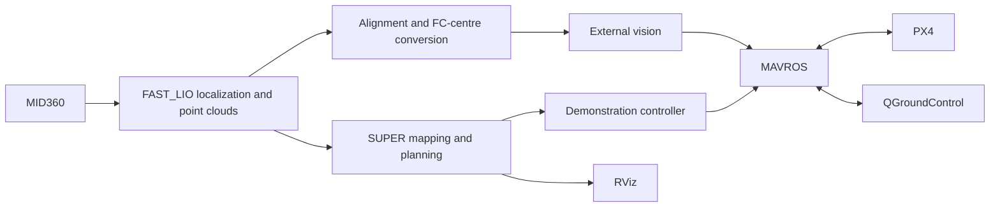

# HKU Open Day · SUPER UAV Demonstration

An indoor localization, planning, and obstacle-avoidance demonstration built on **Livox MID360 → FAST_LIO → SUPER → MAVROS → PX4**.

**[Installation and quick start](docs/QUICK_START.md)** · **[1 m laboratory flight](docs/PHYSICAL_FLIGHT.md)** · [Detailed startup and recovery](docs/REBOOT_QUICK_START.md) · [Documentation index](docs/README.md)

## Quick start

Run these commands on the onboard Ubuntu computer after the
[one-time installation](docs/QUICK_START.md#install-or-update-once).
Normal reboots need no download or rebuild. Keep the aircraft stationary and
disarmed during preparation. Finish the current task before starting another.

### 1. After reboot: complete virtual rehearsal

**Terminal 1**

```bash
python3 ~/Downloads/super_demo_test.py \
  --restart --fixed-lio-extrinsics \
  --fixture-geometry --motion-policy observe --fast-start \
  --calibrate-venue --rear-offset 0.5 \
  --rehearsal-width 2 --rehearsal-height 1.5 --rehearsal-ceiling 2
```

QGC opens automatically. The runner starts localization, measures the session
alignment, and opens the frozen RViz map. Select **LEFT**, then **RIGHT** looking
along the nose, check the cyan box, and type `confirm` in terminal 1.
Use `reset` to pick again or `refresh` for a new snapshot.

After confirmation, preparation continues automatically and the rehearsal RViz
opens. The virtual vehicle rises to **1.5 m**, flies **4.5 m out and back five
times**, hovers at home for **6 seconds**, and lands. The outer box is at most
**2 m wide and 2 m high**, with vehicle extents included. The actual aircraft
remains disarmed; this is real SUPER planning with virtual vehicle feedback,
not a PX4 dynamics simulation.

**Terminal 2**

No command is needed: the virtual mission starts automatically after preparation.
Watch RViz and terminal 1. Completion prints `RESULT: SUCCESS` or `RESULT: FAIL`;
reports are under `~/Downloads/super_demo_tests/<timestamp>/`.
Do not send the physical start service during a rehearsal.
The automatically opened rehearsal RViz shows virtual motion on the captured
map. The [terminal 3 viewer](#terminal-3--live-point-cloud-and-super-planning)
below shows the actual aircraft stack.

### 2. Laboratory flight: 1 m hover target

First create and verify the aircraft configuration using
[the one-time configuration step](docs/PHYSICAL_FLIGHT.md#2-prepare-the-aircraft-configuration-once).
The commands below use `open_day_mission_nominal.json`; its 13.6 cm horizontal
extents are estimates for the confirmed centred-FC, 205 mm X frame and 5-inch
props. Verify that all equipment fits, or use a more accurate measured file.
Do not substitute a virtual fixture. Have an on-site RC operator in POSCTL with
takeover available.

**Terminal 1 — prepare, select boundaries, then wait for READY**

```bash
python3 ~/Downloads/super_demo.py \
  --restart --fixed-lio-extrinsics \
  --mission-file "$HOME/Downloads/open_day_mission_nominal.json" \
  --flight-height 1.0 \
  --calibrate-venue --rear-offset 0.5 \
  --venue-width 2 --venue-ceiling 2 \
  --motion-policy observe \
  --execute --on-site-supervised
```

QGC opens automatically. After fresh localization and alignment, select LEFT,
then RIGHT in RViz and type `confirm` in terminal 1. Each new session needs new
picks. Wait for **`Phase: READY`** and keep terminal 1 running. The selection
window closing does not end preparation, and `confirm` does not arm the aircraft.

**Terminal 2 — start actual flight only after READY and on-site clearance**

```bash
source /opt/ros/humble/setup.zsh
ros2 service call /super_demo/start std_srvs/srv/Trigger '{}'
```

**This requests physical OFFBOARD, arming and mission execution.** The route is
**1 m FC-centre hover target → 4.5 m outbound and return, five round trips →
6-second hover → land**. The **2 m outer ceiling stays unchanged**; the 1 m
hover target is not an altitude limit. SUPER can curve and change altitude for
avoidance within the same vehicle-inclusive box.

#### Terminal 3 — live point cloud and SUPER planning

Open this on the onboard Ubuntu desktop or through NoMachine after terminal 1
has started localization and the planner. You can open it before sending the
start request from terminal 2 and leave it running throughout flight.

```bash
bash --noprofile --norc <<'BASH'
set -e
source /opt/ros/humble/setup.bash
source "$HOME/super_ws/install/setup.bash"
export ROS_DOMAIN_ID=0
export ROS_LOCALHOST_ONLY=0

rviz_view_dir="$HOME/Downloads/super_live_rviz"
rviz_config="$rviz_view_dir/super_ground_3256ff8.rviz"
mkdir -p "$rviz_view_dir"
if [ ! -s "$rviz_config" ]; then
  curl -q --noproxy '*' -fL --connect-timeout 10 --max-time 30 \
    'https://raw.githubusercontent.com/Haofei-Hu/Demo_HKU_open-day_SUPER/3256ff8f87faa8d3c124f49b4cef43fbcdc95071/configs/rviz/super_ground_ros2.rviz' \
    -o "$rviz_config.part"
  mv "$rviz_config.part" "$rviz_config"
fi

rviz_view_id="super_live_rviz_${BASHPID}"
tf2_prefix=$(ros2 pkg prefix tf2_ros)
"$tf2_prefix/lib/tf2_ros/static_transform_publisher" \
  --x 0 --y 0 --z 0 --roll 0 --pitch 0 --yaw 0 \
  --frame-id world --child-frame-id camera_init \
  --ros-args -r "__node:=${rviz_view_id}_tf" \
  -r "/tf_static:=/${rviz_view_id}/tf_static" \
  > "$rviz_view_dir/${rviz_view_id}_tf.log" 2>&1 &
rviz_tf_pid=$!
trap 'kill "$rviz_tf_pid" 2>/dev/null || true; wait "$rviz_tf_pid" 2>/dev/null || true' EXIT

rviz2 -d "$rviz_config" --ros-args -r "__node:=$rviz_view_id" \
  -r "/tf_static:=/${rviz_view_id}/tf_static"
BASH
```

The first run downloads the pinned viewer configuration; later reboots reuse it.
It displays live registered point clouds and the occupied map as **5-pixel
points**, SUPER's main and backup trajectories, planner path and goal markers
when published. Trajectories can be empty before the first goal. During a manual
POSCTL hover with only localization running, the live cloud is available but
SUPER planning overlays are absent.

This viewer uses the physical stack's **ROS domain 0**; the automatic rehearsal
viewer uses isolated domain 197. The identity `world` → `camera_init` display
transform is private to this viewer. Opening or closing it does not send flight
commands; closing RViz also stops its own display-transform process. Keep
terminal 1 running.

To request early landing while the controller is running, use **terminal 2**:

```bash
ros2 service call /super_demo/land std_srvs/srv/Trigger '{}'
```

Use RC takeover for abnormal control. `Ctrl+C` is not a hover or landing command.
After landing and disarming, stop the background stack from terminal 2 before
shutting down the computer:

```bash
python3 ~/Downloads/super_session.py stop
```

Flight reports are under `~/Downloads/super_demo_reports/<timestamp>/`.
Keep the complete directory. READY or a successful rehearsal does not establish
physical flight completion. See [flight details](docs/PHYSICAL_FLIGHT.md) and
[startup recovery](docs/REBOOT_QUICK_START.md) if preparation is rejected.

For takeoff drift or suspected localization/QoS problems, use the
[disarmed manual localization check](docs/GROUND_LOCALIZATION_CHECK.md) to
record direction, scale, rotation and message timing before changing parameters.

## Demonstration mission

| Setting | Value |
|---|---|
| Laboratory physical target height | FC centre **1.0 m above the floor**, explicitly selected with `--flight-height 1.0` |
| Virtual target height in the quick start | 1.5 m (`--rehearsal-height 1.5`; software default remains 0.5 m) |
| Route | 4.5 m outbound → return to the original hover point, **five round trips** |
| Final stages | Hover for 6 seconds → land → confirm landed and disarmed |
| Planning speed / acceleration targets | 2 m/s / 1 m/s² |
| Trajectory acceptance bounds | 4 m/s / 2 m/s² |
| Laboratory operating box | 5.8 m forward, at most 2 m wide and 2 m high; vehicle extents included |
| Default outer venue dimensions | 5.8 m forward × 2.8 m wide × 2.8 m high; RViz calibration uses the selected lateral width exactly |

SUPER replans continuously and may follow curved obstacle-avoiding routes. Each return is planned back to the original hover point while retaining the takeoff heading. The selected hover height is the takeoff and mission target height, not the ceiling; three-dimensional avoidance may change altitude along the route. There is no additional whole-mission or first-trajectory waiting deadline.

The `observe` policy records motion exceedances while retaining venue, freshness, and continuity checks. Physical execution needs aircraft-envelope and placement verification; the laboratory guide labels nominal dimensions as estimates; rehearsal `--fixture-geometry` is not a physical survey.

## System architecture



The onboard computer connects to the flight controller over USB and provides remote desktop access over Wi-Fi. QGC uses MAVROS UDP forwarding. The onboard environment is Ubuntu 22.04 with ROS 2 Humble. This repository provides integration scripts, configurations, and patches; Livox, FAST_LIO, SUPER, and MAVROS workspaces must already be installed.

## Validation scope

A complete five-round mission has passed with actual captured point clouds, real SUPER, and virtual vehicle feedback. Earlier physical takeoff, hover, and landing tests have separate field records. **The complete physical demonstration remains to be validated on site.** See [verification and known issues](docs/VALIDATION.md); historical debugging notes are not current startup instructions.

## Repository structure

| Directory | Contents |
|---|---|
| `scripts/maintenance/` | Installation, startup, automatic tests, and configuration generation |
| `scripts/localization/` | Alignment and external vision |
| `scripts/planning/`, `scripts/flight/` | Trajectory handoffs, venue constraints, and mission control |
| `scripts/simulation/` | Virtual ground rehearsal |
| `configs/` | Missions, RViz settings, and release manifests |
| `docs/` | User guides and technical references |
| `tests/`, `data/` | Regression checks and verification evidence |

Deployed commands use `~/Downloads/<script_name>`. See the [script index](scripts/README.md) and [development checks](docs/DEVELOPMENT.md).

[SUPER](https://github.com/hku-mars/SUPER) · [FAST_LIO](https://github.com/hku-mars/FAST_LIO/tree/ROS2) · [Livox Driver](https://github.com/Livox-SDK/livox_ros_driver2) · [MAVROS](https://github.com/mavlink/mavros) · [PX4](https://docs.px4.io/)
