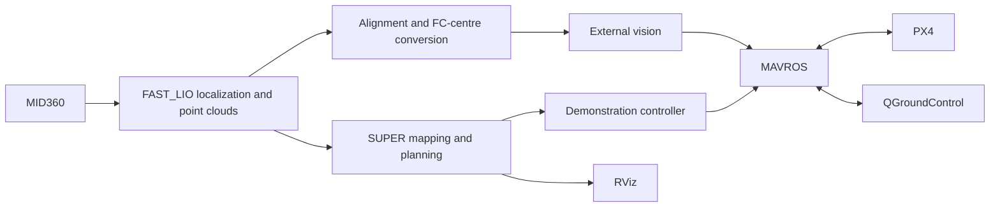

# HKU Open Day · SUPER UAV Demonstration

An indoor localization, planning, and obstacle-avoidance demonstration built on **Livox MID360 → FAST_LIO → SUPER → MAVROS → PX4**.

**[Installation and quick start](docs/QUICK_START.md)** · **[1 m laboratory flight](docs/PHYSICAL_FLIGHT.md)** · [Detailed startup and recovery](docs/REBOOT_QUICK_START.md) · [Documentation index](docs/README.md)

## Start here

| Goal | Guide |
|---|---|
| Install or update the matching scripts | [Complete installer and one-time build](docs/QUICK_START.md#install-or-update-once) |
| Run an automatic ground rehearsal after reboot | Use the command below; alignment is captured automatically |
| Run the physical demonstration in a laboratory | [Aircraft configuration, preparation, start, and landing](docs/PHYSICAL_FLIGHT.md) |
| Choose left/right boundaries after placing the aircraft | [Per-session RViz boundary calibration](docs/RVIZ_VENUE_CALIBRATION.md) |
| Inspect results or troubleshoot startup and planning | [Reports and recovery](docs/QUICK_START.md#reports-and-results) |
| Understand the system or contribute | [Documentation index](docs/README.md) |

The current release adds per-session RViz left/right boundary selection to physical preparation. This Python feature requires no new C++ rebuild when the nine current venue markers are already installed. Older installations still need the [one-time source patch and rebuild](docs/QUICK_START.md#install-or-update-once); normal reboots then use the same command below.

## Ground rehearsal after every reboot

With the matching scripts and ROS workspaces installed, open one terminal on the onboard Ubuntu computer. Keep the physical aircraft stationary and disarmed:

```bash
python3 ~/Downloads/super_demo_test.py \
  --restart --fixed-lio-extrinsics \
  --fixture-geometry --motion-policy observe --fast-start
```

The runner opens QGC, starts localization and external vision, captures the session alignment quaternion and map, and opens RViz to display real SUPER planning with a virtual vehicle. Point clouds use a 5-pixel display size. Normal reboots require no download or rebuild.

To select the venue's lateral boundaries before each rehearsal, add
`--calibrate-venue --rear-offset 0.5` when the rear offset is 0.5 m. After LEFT,
RIGHT and `confirm`, the runner automatically continues through the full virtual
mission. See [point selection and automatic continuation](docs/RVIZ_VENUE_CALIBRATION.md#select-points-then-automatically-run-the-complete-rehearsal).

The final output is `RESULT: SUCCESS` or `RESULT: FAIL`, with reports under `~/Downloads/super_demo_tests/<timestamp>/`. This rehearsal uses a real map and planner with virtual vehicle feedback. It is not a PX4 dynamics simulation and does not fly the physical aircraft.

## Demonstration mission

| Setting | Value |
|---|---|
| Laboratory physical target height | FC centre **1.0 m above the floor**, explicitly selected with `--flight-height 1.0` |
| Virtual ground-rehearsal target height | 0.5 m |
| Route | 4.5 m outbound → return to the original hover point, **five round trips** |
| Final stages | Hover for 6 seconds → land → confirm landed and disarmed |
| Planning speed / acceleration targets | 2 m/s / 1 m/s² |
| Trajectory acceptance bounds | 4 m/s / 2 m/s² |
| Laboratory operating box | 5.8 m forward, at most 2 m wide and 2 m high; vehicle extents included |
| Default outer venue dimensions | 5.8 m forward × 2.8 m wide × 2.8 m high; RViz calibration uses the selected lateral width exactly |

SUPER replans continuously and may follow curved obstacle-avoiding routes. Each return is planned back to the original hover point while retaining the takeoff heading. The selected hover height is the takeoff and mission target height, not the ceiling; three-dimensional avoidance may change altitude along the route. There is no additional whole-mission or first-trajectory waiting deadline.

The `observe` policy records motion exceedances while retaining venue, freshness, and continuity checks. Physical execution needs aircraft-envelope and placement verification; the laboratory guide labels nominal dimensions as estimates; rehearsal `--fixture-geometry` is not a physical survey.

## System architecture



The onboard computer connects to the flight controller over USB and provides remote desktop access over Wi-Fi. QGC uses MAVROS UDP forwarding. The onboard environment is Ubuntu 22.04 with ROS 2 Humble. This repository provides integration scripts, configurations, and patches; Livox, FAST_LIO, SUPER, and MAVROS workspaces must already be installed.

## Validation scope

A complete five-round mission has passed with actual captured point clouds, real SUPER, and virtual vehicle feedback. Earlier physical takeoff, hover, and landing tests have separate field records. **The complete physical demonstration remains to be validated on site.** See [verification and known issues](docs/VALIDATION.md); historical debugging notes are not current startup instructions.

## Repository structure

| Directory | Contents |
|---|---|
| `scripts/maintenance/` | Installation, startup, automatic tests, and configuration generation |
| `scripts/localization/` | Alignment and external vision |
| `scripts/planning/`, `scripts/flight/` | Trajectory handoffs, venue constraints, and mission control |
| `scripts/simulation/` | Virtual ground rehearsal |
| `configs/` | Missions, RViz settings, and release manifests |
| `docs/` | User guides and technical references |
| `tests/`, `data/` | Regression checks and verification evidence |

Deployed commands use `~/Downloads/<script_name>`. See the [script index](scripts/README.md) and [development checks](docs/DEVELOPMENT.md).

[SUPER](https://github.com/hku-mars/SUPER) · [FAST_LIO](https://github.com/hku-mars/FAST_LIO/tree/ROS2) · [Livox Driver](https://github.com/Livox-SDK/livox_ros_driver2) · [MAVROS](https://github.com/mavlink/mavros) · [PX4](https://docs.px4.io/)
