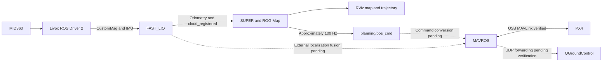

# Demo_HKU_open-day_SUPER

Deployment and integration notes for the SUPER UAV demonstration used at the HKU Open Day.

**Last updated: September 29, 2026**

**Current status: The MID360 → FAST_LIO → SUPER perception and planning pipeline has been verified. MAVROS is connected to PX4. External localization fusion and real flight control are still in progress.**

## 1. Quick Start: LiDAR and QGroundControl

These commands are intended for Ubuntu 22.04 with ROS 2 Humble and zsh.

Run each command separately. Do not copy the terminal prompt, HTML line-break tags, or trailing backslashes.

### MID360 for FAST_LIO using Livox CustomMsg

```bash
source /opt/ros/humble/setup.zsh
source ~/ws_livox/install/setup.zsh
ros2 launch livox_ros_driver2 msg_MID360_launch.py
```

Keep this terminal running.

Verified output rates:

```text
/livox/lidar: approximately 10 Hz
/livox/imu: approximately 200 Hz
```

### QGroundControl

```bash
~/Downloads/QGroundControl-x86_64.AppImage
```

If the AppImage does not have execution permission:

```bash
chmod +x ~/Downloads/QGroundControl-x86_64.AppImage
```

Connection notes:

- QGroundControl can connect directly to the flight controller through USB for standalone inspection.
- During MAVROS integration, close QGroundControl before starting MAVROS because MAVROS must open the USB serial device.
- MAVROS is configured to forward MAVLink to UDP port 14550 for QGroundControl.
- The MAVROS-to-QGroundControl UDP connection has not yet been fully verified.

### MID360 with RViz for raw point-cloud inspection

```bash
source /opt/ros/humble/setup.zsh
source ~/ws_livox/install/setup.zsh
ros2 launch livox_ros_driver2 rviz_MID360_launch.py
```

This mode is only for viewing the raw PointCloud2 data.

Use `msg_MID360_launch.py` for FAST_LIO integration. Do not run both MID360 launch files at the same time.

## 2. Current Progress

| Module | Status | Verification |
| --- | --- | --- |
| SUPER build and click_demo | Completed | The simulator moves successfully after fixing the backup-trajectory parameter |
| MID360 network and driver | Completed | CustomMsg point cloud at approximately 10 Hz and IMU at approximately 200 Hz |
| FAST_LIO ROS 2 build | Completed | Official ROS2 branch and ikd-Tree submodule compiled successfully |
| FAST_LIO odometry and point cloud | Basic verification completed | `/Odometry` and `/cloud_registered` both publish at approximately 10 Hz |
| FAST_LIO frame consistency | Completed | Both outputs use `camera_init` |
| SUPER real-sensor input | Completed | FAST_LIO odometry and point cloud are received by SUPER |
| ROG-Map | Completed | Occupancy voxels are visible in RViz |
| Planning on real point-cloud data | Basic verification completed | `GenerateExpTrajectory SUCCESS`, `FOLLOW_TRAJ`, and `ReplanOnce succeed` were observed |
| Clicked goal height | Adjusted | Changed from 1.5 m to -0.19 m in the current FAST_LIO coordinate frame |
| SUPER command output | Completed | `/planning/pos_cmd` publishes at approximately 99.5–100 Hz |
| QGroundControl direct USB connection | Completed | Firmware and MAVLink status were read successfully |
| MAVROS connection to PX4 | Completed | `/mavros/state` reports `connected: true` |
| PX4 local position and estimator state | Pending | The next step is to inspect local position and estimator topics |
| FAST_LIO external vision input to PX4 | Not completed | Frames, timestamps, extrinsics, and EKF fusion are not configured |
| SUPER command conversion for PX4 | Not completed | The command bridge has not yet been implemented |
| QGroundControl through MAVROS UDP forwarding | Pending verification | Forwarding is configured but has not yet been tested |
| Offboard closed-loop control | Not verified | Current results cover perception, planning, command output, and communication only |
| Autonomous real flight | Not verified | No real autonomous flight test has been completed |

`FOLLOW_TRAJ` is an internal SUPER state. It does not mean the real UAV has followed or completed the trajectory.

## 3. Environment and Versions

| Item | Current value |
| --- | --- |
| Operating system | Ubuntu 22.04 |
| ROS | ROS 2 Humble |
| Shell | zsh |
| Livox ROS Driver 2 | Version 1.2.7 shown in the runtime log |
| SUPER commit | `2ad3419c127a617c6d7df6925e81a14175a9c096` |
| FAST_LIO branch | `ROS2` |
| FAST_LIO commit | `a4743b095409588842a5b30ddfa27e29d2f99164` |
| ikd-Tree commit | `e2e3f4e9d3b95a9e66b1ba83dc98d4a05ed8a3c4` |
| MAVROS | 2.14.0 |
| mavros-extras | 2.14.0 |
| Flight-controller architecture | `HKUST_NXT_DUAL` |
| Flight-controller MCU | STM32H7 |
| PX4 firmware | Release 1.17.0, custom board build |
| PX4 git hash | `d6f12ad1c4f70ad3230afd7d86e971421e02fef4` |
| Firmware build time | May 13, 2026, 18:40:15 |
| Flight-controller connection | USB |
| Ubuntu serial device | `/dev/ttyACM0` |
| Current DDS configuration | `UXRCE_DDS_CFG = 0` |
| uXRCE-DDS client | Present in the firmware but not running |

Workspace paths:

```text
~/ws_livox/                         Livox workspace
~/fastlio_ws/                       FAST_LIO workspace
~/fastlio_ws/src/FAST_LIO/          FAST_LIO source
~/super_ws/                         SUPER workspace
~/super_ws/src/SUPER/               SUPER source
~/fastlio_ws/mid360_super.rviz      Saved RViz configuration
~/Downloads/QGroundControl-x86_64.AppImage
```

The RViz configuration was initially intended to be saved under `~/super_ws/`, but the RViz window title later showed:

```text
~/fastlio_ws/mid360_super.rviz
```

Use the path that exists on the deployment computer.

## 4. Current Data Pipeline



## 5. Complete Startup Sequence

Use a separate terminal for each continuously running process.

The following sequence assumes that all packages have already been built and configured.

### Terminal 1: MID360 driver

```bash
source /opt/ros/humble/setup.zsh
source ~/ws_livox/install/setup.zsh
ros2 launch livox_ros_driver2 msg_MID360_launch.py
```

A successful startup includes a message similar to:

```text
livox/lidar publish use livox custom format
```

Keep this terminal running.

### Terminal 2: FAST_LIO

```bash
source /opt/ros/humble/setup.zsh
source ~/ws_livox/install/setup.zsh
source ~/fastlio_ws/install/setup.zsh
ros2 launch fast_lio mapping.launch.py config_file:=mid360.yaml
```

Keep the LiDAR stationary for several seconds during initialization.

Expected initialization messages include:

```text
IMU Initial Done
Initialize the map kdtree
```

This launch file also starts RViz.

To load the saved RViz configuration, use:

```text
RViz → File → Open Config
```

Then select:

```text
/home/mars/fastlio_ws/mid360_super.rviz
```

### Terminal 3: visualization frame alignment

```bash
source /opt/ros/humble/setup.zsh
ros2 run tf2_ros static_transform_publisher --x 0 --y 0 --z 0 --roll 0 --pitch 0 --yaw 0 --frame-id world --child-frame-id camera_init
```

FAST_LIO publishes data in `camera_init`, while SUPER publishes visualization markers in `world`.

The current integration treats their numerical coordinates as identical, so this static transform makes the frames overlap in RViz.

This transform is only for the current planning and visualization convention. It does not prove that:

- FAST_LIO is aligned with the PX4 local frame.
- The LiDAR-to-body extrinsic calibration is correct.
- The `camera_init` X axis points north.
- ENU and NED transformations have been handled correctly.

### Terminal 4: SUPER with real sensor data

Create the log directories once:

```bash
mkdir -p ~/super_ws/src/SUPER/super_planner/log/replan_logs
mkdir -p ~/super_ws/src/SUPER/super_planner/log/cmd_logs
```

Load ROS 2 and SUPER:

```bash
source /opt/ros/humble/setup.zsh
source ~/super_ws/install/setup.zsh
```

Start the planner:

```bash
ros2 run super_planner fsm_node --ros-args -p config_name:=mid360_real_ros2.yaml
```

A normal waiting state is:

```text
Wait for goal
Current state: INIT
```

Use this standalone planner command for real-sensor integration.

Do not use `click_demo.launch.py` for real-sensor integration because that launch file also starts the ideal drone simulator. The simulator publishes its own point cloud and odometry, which can conflict with the real FAST_LIO data.

### Terminal 5: MAVROS

Close QGroundControl if it is directly connected to `/dev/ttyACM0`.

Load ROS 2:

```bash
source /opt/ros/humble/setup.zsh
```

Start MAVROS:

```bash
ros2 launch mavros px4.launch fcu_url:="serial:///dev/ttyACM0:2000000" gcs_url:="udp://:14555@127.0.0.1:14550"
```

The USB connection between MAVROS and PX4 has been verified.

This command does not convert SUPER commands into PX4 setpoints. The UAV will not follow `/planning/pos_cmd` automatically.

The following MAVROS requirements were checked:

- `/usr/share/GeographicLib/geoids/egm96-5.pgm` exists.
- User `mars` belongs to the `dialout` group.
- The flight controller appears as `/dev/ttyACM0`.

After reconnecting the USB cable, check the device name again because it may change.

### Terminal 6: system checks

Load all required environments:

```bash
source /opt/ros/humble/setup.zsh
source ~/ws_livox/install/setup.zsh
source ~/fastlio_ws/install/setup.zsh
source ~/super_ws/install/setup.zsh
```

Run each frequency check separately and stop it with `Ctrl+C` after several seconds:

```bash
ros2 topic hz /livox/lidar
```

```bash
ros2 topic hz /livox/imu
```

```bash
ros2 topic hz /Odometry
```

```bash
ros2 topic hz /cloud_registered
```

```bash
ros2 topic hz /planning/pos_cmd
```

Check the MAVROS connection:

```bash
ros2 topic echo /mavros/state --once
```

The verified MAVROS state was:

```yaml
connected: true
armed: false
guided: true
manual_input: false
mode: AUTO.LOITER
system_status: 0
```

This is only a connection-state snapshot.

`guided: true` does not prove that the flight controller is currently in Offboard mode, and it does not prove that the estimator is ready.

## 6. MID360 Network Configuration

### Current network settings

| Item | Value |
| --- | --- |
| Ubuntu Ethernet interface | `enp4s0` |
| Ubuntu IP | `192.168.50.125/24` |
| MID360 IP | `192.168.50.163` |

Check the network interfaces:

```bash
ip -br addr
```

Ping the LiDAR:

```bash
ping -I enp4s0 -c 4 192.168.50.163
```

Check the neighbor table:

```bash
ip neigh show dev enp4s0
```

Inspect MID360 network traffic:

```bash
sudo tcpdump -ni enp4s0 -nn host 192.168.50.163
```

Check the source configuration:

```bash
grep -n '192.168.' ~/ws_livox/src/livox_ros_driver2/config/MID360_config.json
```

Check the installed configuration:

```bash
grep -n '192.168.' ~/ws_livox/install/livox_ros_driver2/share/livox_ros_driver2/config/MID360_config.json
```

When changing the MID360 network settings, preserve the complete JSON structure and all port fields. Only change the relevant IP addresses.

## 7. FAST_LIO Installation

### Clone FAST_LIO

```bash
mkdir -p ~/fastlio_ws/src
```

```bash
git clone --branch ROS2 --single-branch --recursive https://github.com/hku-mars/FAST_LIO.git ~/fastlio_ws/src/FAST_LIO
```

Verify the source version:

```bash
git -C ~/fastlio_ws/src/FAST_LIO rev-parse HEAD
```

Expected commit during this deployment:

```text
a4743b095409588842a5b30ddfa27e29d2f99164
```

Verify the ikd-Tree submodule:

```bash
git -C ~/fastlio_ws/src/FAST_LIO submodule status
```

Expected submodule commit:

```text
e2e3f4e9d3b95a9e66b1ba83dc98d4a05ed8a3c4
```

### Install dependencies

```bash
source /opt/ros/humble/setup.zsh
source ~/ws_livox/install/setup.zsh
rosdep install --from-paths ~/fastlio_ws/src --ignore-src -r -y
```

### Build FAST_LIO

```bash
cd ~/fastlio_ws
```

```bash
colcon build --symlink-install --cmake-args -DCMAKE_BUILD_TYPE=Release
```

Load the result:

```bash
source ~/fastlio_ws/install/setup.zsh
```

### FAST_LIO MID360 configuration

Configuration file:

```text
~/fastlio_ws/src/FAST_LIO/config/mid360.yaml
```

Important parameters:

| Parameter | Current value |
| --- | --- |
| `common.lid_topic` | `/livox/lidar` |
| `common.imu_topic` | `/livox/imu` |
| `common.time_sync_en` | `false` |
| `common.time_offset_lidar_to_imu` | `0.0` |
| `preprocess.lidar_type` | `1` |
| `preprocess.scan_rate` | `10` |
| `mapping.extrinsic_est_en` | `true` |
| `pcd_save.pcd_save_en` | `false` |

Automatic PCD saving was disabled:

```yaml
pcd_save:
  pcd_save_en: false
  interval: -1
```

The original configuration could accumulate all frames into one PCD file, which may consume excessive memory or disk space during long runs.

The current setup has been verified for basic mapping and topic output. Long-term drift, motion performance, time synchronization, and extrinsic accuracy still require dedicated testing.

## 8. SUPER Real-Sensor Configuration

### Configuration file

The original simulation configuration was preserved.

A separate real-sensor configuration was created:

```text
~/super_ws/src/SUPER/super_planner/config/mid360_real_ros2.yaml
```

It was copied from the corrected simulation configuration:

```bash
cp ~/super_ws/src/SUPER/super_planner/config/click_smooth_ros2.yaml ~/super_ws/src/SUPER/super_planner/config/mid360_real_ros2.yaml
```

### Important current values

The following table lists important parameters. It is not a complete replacement YAML file.

| Parameter | Current value |
| --- | --- |
| `fsm.click_goal_topic` | `/goal_pose` |
| `fsm.click_height` | `-0.19` |
| `fsm.cmd_topic` | `/planning/pos_cmd` |
| `rog_map.ros_callback.cloud_topic` | `/cloud_registered` |
| `rog_map.ros_callback.odom_topic` | `/Odometry` |
| `rog_map.resolution` | `0.1` |
| `rog_map.inflation_resolution` | `0.2` |
| `rog_map.inflation_step` | `2` |
| `rog_map.virtual_ground_height` | `-1.0` |
| `rog_map.raycasting.enable` | `true` |
| `traj_opt.backup_traj.penna_thr` | `1.0e+5` |
| `traj_opt.boundary.max_omg` | `2.5` |

After changing the YAML file, restart the SUPER process so that it reloads the parameters.

The runtime log confirmed that SUPER loaded:

```text
/home/mars/super_ws/src/SUPER/super_planner/config/mid360_real_ros2.yaml
```

## 9. Fixed Issues

### 9.1 Backup-trajectory parameter name

The original backup-trajectory configuration used:

```yaml
penna_max_acc_thr: 1.0e+5
```

The current source loader reads:

```yaml
penna_thr: 1.0e+5
```

The backup configuration was changed to:

```yaml
backup_traj:
  penna_thr: 1.0e+5
```

After this correction, `click_demo` successfully generated a trajectory and moved the simulated vehicle.

Temporarily increasing `max_omg` was not the actual fix. It was restored to:

```yaml
max_omg: 2.5
```

Planning still succeeded after restoring this value.

Related discussion:

- [SUPER Issue #20](https://github.com/hku-mars/SUPER/issues/20#issuecomment-3323124309)

### 9.2 Virtual-ground warning

Observed warning:

```text
Odom below virtual ground, please check map parameter
```

At that time, the FAST_LIO Z position was approximately:

```text
-0.217 m
```

ROG-Map adjusts the effective virtual-ground height using the inflation parameters.

For the current source, the calculation is approximately:

```text
effective_ground =
    [floor(configured_ground / inflation_resolution) + inflation_step]
    × inflation_resolution
    + 0.5 × inflation_resolution
```

Current inflation settings:

```yaml
resolution: 0.1
inflation_resolution: 0.2
inflation_step: 2
```

Result:

| Configured ground | Effective ground | Result |
| --- | --- | --- |
| `-0.5 m` | Approximately `-0.1 m` | The odometry remained below the effective ground |
| `-1.0 m` | Approximately `-0.5 m` | The odometry passed the height check |

The configuration was therefore changed to:

```yaml
virtual_ground_height: -1.0
```

This value is currently used for integration testing. The actual floor position still needs to be confirmed from the point cloud.

FAST_LIO may choose a different origin after restarting, so the current Z position and ground settings should be checked again after each fresh initialization.

### 9.3 Goal trajectory appeared as a diagonal line

The original configuration contained:

```yaml
click_height: 1.5
```

This parameter overrides the Z value of the goal message.

Even when the user clicked on a horizontal plane in RViz, SUPER changed the goal to:

```text
z = 1.5 m
```

The measured FAST_LIO height was approximately:

```text
z = -0.186 m
```

This created a vertical difference of approximately 1.69 m, so the planned trajectory rose diagonally.

For same-height planning tests, the parameter was changed to:

```yaml
click_height: -0.19
```

This is a fixed coordinate value in the current FAST_LIO frame. It is not height above the physical floor and it does not automatically follow the current vehicle altitude.

SUPER may still change altitude along the middle of a trajectory to avoid obstacles.

### 9.4 SUPER log-writing error

Observed error during shutdown:

```text
Error: Could not open file for writing
```

SUPER saves replanning and command logs during destruction.

The required directories were created:

```bash
mkdir -p ~/super_ws/src/SUPER/super_planner/log/replan_logs
mkdir -p ~/super_ws/src/SUPER/super_planner/log/cmd_logs
```

Future shutdowns should be checked to confirm that both log files are written successfully.

## 10. RViz Configuration

### Global frame

Set:

```text
Global Options
└── Fixed Frame: world
```

### SUPER occupancy map

Add:

```text
Topic: /rog_map/occ
Display type: PointCloud2
```

Set the topic QoS to:

```text
Reliability Policy: Best Effort
Durability Policy: Volatile
```

Recommended display properties:

```text
Style: Boxes
Size (m): 0.1
Alpha: 1
Position Transformer: XYZ
Color Transformer: FlatColor
Color: 255; 255; 255
```

During testing, `/rog_map/occ` contained 7637 points but initially did not appear in RViz.

The cause was a QoS mismatch. SUPER publishes the map with Best Effort reliability. After changing the RViz subscription to Best Effort, the occupancy voxels appeared.

`Status: Ok` alone does not prove that RViz is receiving a non-empty point cloud.

### SUPER trajectory

Add:

```text
Topic: /visualization/committed_traj
Display type: MarkerArray
```

Set:

```text
Reliability Policy: Best Effort
Durability Policy: Volatile
```

### Sending a goal

Open:

```text
Panels → Tool Properties
```

Set:

```text
2D Goal Pose → Topic: /goal_pose
```

Then:

1. Select **2D Goal Pose** from the RViz toolbar.
2. Click in a nearby free area.
3. Hold and drag the mouse to choose the goal heading.
4. Release the mouse button to send the goal.

Do not use **2D Pose Estimate** to send a goal. It is intended for initial-pose estimation.

Successful planning logs include:

```text
GenerateExpTrajectory SUCCESS
change state from [GENERATE_TRAJ] to [FOLLOW_TRAJ]
ReplanOnce succeed
```

Because PX4 is not yet executing the SUPER trajectory, the real LiDAR position does not move with the command.

A trajectory may finish and be replanned even though the real UAV has not reached the goal.

## 11. Topic Verification

### Livox message type

```bash
ros2 topic type /livox/lidar
```

Expected:

```text
livox_ros_driver2/msg/CustomMsg
```

If the message type is reported as invalid:

```bash
source ~/ws_livox/install/setup.zsh
```

### FAST_LIO output topics

```bash
ros2 topic list | grep -E 'cloud_registered|Odometry|path'
```

Expected topics:

```text
/Odometry
/cloud_registered
/cloud_registered_body
/path
```

Check the output frames:

```bash
ros2 topic echo /Odometry --once --field header
```

```bash
ros2 topic echo /cloud_registered --once --field header
```

Both were verified with:

```text
frame_id: camera_init
```

### SUPER map width

```bash
ros2 topic echo /rog_map/occ --once --field width
```

Example result:

```text
7637
```

This confirms that the map point cloud is not empty.

### SUPER command type

```bash
ros2 topic type /planning/pos_cmd
```

Expected:

```text
mars_quadrotor_msgs/msg/PositionCommand
```

If the message type is reported as invalid:

```bash
source ~/super_ws/install/setup.zsh
```

### SUPER command frequency

```bash
ros2 topic hz /planning/pos_cmd
```

Verified rate:

```text
Approximately 99.5–100 Hz
```

## 12. PX4 and MAVROS

### Flight-controller information

QGroundControl reported:

```text
Hardware architecture: HKUST_NXT_DUAL
PX4 version: Release 1.17.0
PX4 git hash: d6f12ad1c4f70ad3230afd7d86e971421e02fef4
Operating system: NuttX 11.0.0
MCU: STM32H7
USB device on Ubuntu: /dev/ttyACM0
```

### MAVLink status

QGroundControl's MAVLink Console reported:

```text
type: USB CDC
MAVLink version: 2
transport protocol: serial (/dev/ttyACM0 @2000000)
```

### uXRCE-DDS status

The following commands were run in the QGroundControl MAVLink Console:

```text
param show UXRCE_DDS_CFG
```

Result:

```text
UXRCE_DDS_CFG: 0
```

The client status was checked with:

```text
uxrce_dds_client status
```

Result:

```text
uxrce_dds_client not running
```

The current integration therefore uses MAVROS over USB MAVLink. It does not currently use the PX4 uXRCE-DDS bridge.

### USB serial permission

Device:

```text
/dev/ttyACM0
```

Permission:

```text
crw-rw---- root dialout
```

User `mars` belongs to the `dialout` group, so the serial device can be opened without using `sudo`.

### MAVROS installation

Installed packages:

```text
ros-humble-mavros: 2.14.0
ros-humble-mavros-extras: 2.14.0
```

The required GeographicLib geoid file exists:

```text
/usr/share/GeographicLib/geoids/egm96-5.pgm
```

### MAVROS launch

Close QGroundControl before allowing MAVROS to open the USB serial device:

```bash
source /opt/ros/humble/setup.zsh
```

```bash
ros2 launch mavros px4.launch fcu_url:="serial:///dev/ttyACM0:2000000" gcs_url:="udp://:14555@127.0.0.1:14550"
```

Check the connection:

```bash
ros2 topic echo /mavros/state --once
```

Verified output:

```yaml
connected: true
armed: false
guided: true
manual_input: false
mode: AUTO.LOITER
system_status: 0
```

## 13. Troubleshooting

### No Livox data

Check the Ethernet interface:

```bash
ip -br addr
```

Check the physical link:

```bash
cat /sys/class/net/enp4s0/carrier
```

Expected result:

```text
1
```

Check the Ethernet speed:

```bash
sudo ethtool enp4s0 | grep -E 'Speed|Duplex|Link detected'
```

Ping the LiDAR:

```bash
ping -I enp4s0 -c 4 192.168.50.163
```

Inspect incoming packets:

```bash
sudo tcpdump -ni enp4s0 -nn host 192.168.50.163
```

### ROS 2 reports an invalid Livox message type

Load the Livox workspace:

```bash
source ~/ws_livox/install/setup.zsh
```

Then retry:

```bash
ros2 topic hz /livox/lidar
```

### ROS 2 reports an invalid SUPER message type

Load the SUPER workspace:

```bash
source ~/super_ws/install/setup.zsh
```

Then retry:

```bash
ros2 topic hz /planning/pos_cmd
```

Each new terminal must load the required workspace environments.

### SUPER reports `No odom`

Check the odometry frequency:

```bash
ros2 topic hz /Odometry
```

Inspect the publisher and subscribers:

```bash
ros2 topic info /Odometry --verbose
```

The current SUPER FSM source treats odometry as stale after 0.1 seconds.

FAST_LIO publishes at approximately 10 Hz, and a maximum interval of approximately 0.139 seconds was observed. Timing jitter can therefore trigger occasional `No odom` messages.

A previous continuous `No odom` condition was not fully diagnosed. Planning later recovered without modifying the timeout threshold.

Selecting **2D Pose Estimate** instead of **2D Goal Pose** explains why a planning goal was not sent, but it does not directly explain missing odometry.

### RViz map topic is valid but nothing is visible

Check whether the point cloud contains points:

```bash
ros2 topic echo /rog_map/occ --once --field width
```

Then set the RViz topic QoS to:

```text
Reliability Policy: Best Effort
Durability Policy: Volatile
```

### Terminal reports `parse error near '<'`

This usually happens when HTML markup such as `<br/>` is copied into the shell.

Copy only the command text inside a code block.

### Terminal reports `no such file or directory: br/`

This is also caused by copying an HTML line-break tag into the terminal.

Cancel the command with `Ctrl+C` and enter the command again manually.

### Terminal shows a `>` continuation prompt

A quote or trailing backslash was probably left open.

Press:

```text
Ctrl+C
```

Then enter the command again without a trailing backslash.

## 14. Current Integration Boundary

The current verified pipeline is:

```text
MID360
  → Livox ROS Driver 2
  → FAST_LIO
  → SUPER / ROG-Map
  → trajectory generation
  → /planning/pos_cmd at approximately 100 Hz
```

MAVROS is connected to PX4, but the following control path is not yet implemented:

```text
/planning/pos_cmd
  → command conversion and frame transformation
  → MAVROS setpoint
  → PX4 Offboard control
```

The SUPER command message is:

```text
mars_quadrotor_msgs/msg/PositionCommand
```

It cannot be forwarded directly to PX4 without conversion.

Important interface details:

- `position` is expressed in the SUPER planning frame.
- `velocity`, `acceleration`, and `jerk` require coordinate-frame verification.
- `attitude` contains Euler-angle values, not a quaternion.
- `thrust.z` is related to acceleration magnitude and is not normalized PX4 throttle.
- PX4 commonly uses NED and FRD conventions, while ROS commonly uses ENU and FLU conventions.
- Frame conversion, yaw conversion, timestamps, command freshness, failsafe behavior, and trajectory-end behavior must be implemented explicitly.

## 15. Next Steps

**Current continuation point: MAVROS is connected to PX4, but PX4 local-position and estimator topics have not yet been checked.**

In a terminal with ROS 2 loaded, run:

```bash
timeout 10s ros2 topic echo /mavros/local_position/pose --once
```

Then run:

```bash
timeout 10s ros2 topic echo /mavros/estimator_status --once
```

Remaining work:

- [ ] Verify PX4 local-position output.
- [ ] Verify PX4 estimator status.
- [ ] Check the publication rates of the PX4 state topics.
- [ ] Verify QGroundControl through MAVROS UDP forwarding.
- [ ] Determine the FAST_LIO-to-PX4 frame transformation.
- [ ] Confirm LiDAR-to-body extrinsic calibration.
- [ ] Confirm time synchronization and timestamp behavior.
- [ ] Publish FAST_LIO external localization to PX4.
- [ ] Configure and verify PX4 EKF external-vision fusion.
- [ ] Implement the SUPER PositionCommand-to-MAVROS bridge.
- [ ] Verify position, velocity, acceleration, and yaw conversions.
- [ ] Implement continuous setpoint streaming.
- [ ] Implement command timeout handling.
- [ ] Implement trajectory-end position hold.
- [ ] Verify Offboard mode transitions without propellers.
- [ ] Perform controlled closed-loop tests.
- [ ] Perform a real autonomous flight test only after all previous checks pass.

## 16. References

- [This project](https://github.com/Haofei-Hu/Demo_HKU_open-day_SUPER)
- [SUPER](https://github.com/hku-mars/SUPER)
- [FAST_LIO ROS2 branch](https://github.com/hku-mars/FAST_LIO/tree/ROS2)
- [Livox ROS Driver 2](https://github.com/Livox-SDK/livox_ros_driver2)
- [MAVROS ROS 2 connection URLs](https://github.com/mavlink/mavros/blob/ros2/docs/connection_urls.md)
- [PX4 uXRCE-DDS documentation](https://docs.px4.io/main/en/middleware/uxrce_dds)

This README records the deployment and integration completed on the current Ubuntu computer.

Whether the modified configuration files, RViz configuration, and future command-bridge source files have been committed to this repository must be verified against the actual repository contents.
### Terminal 1 — Start MID360 with RViz

Use this mode to display the raw LiDAR point cloud.

```bash
source /opt/ros/humble/setup.zsh
source ~/ws_livox/install/setup.zsh
ros2 launch livox_ros_driver2 rviz_MID360_launch.py
```

### Terminal 2 — Start QGroundControl

```bash
~/Downloads/QGroundControl-x86_64.AppImage
```

If permission is denied, run this once, then launch QGC again:

```bash
chmod +x ~/Downloads/QGroundControl-x86_64.AppImage
```

### Alternative — MID360 for FAST-LIO

Use CustomMsg mode when working with FAST-LIO.

Stop the existing Livox driver with Ctrl+C before switching modes.
Run only one Livox driver instance.

```bash
source /opt/ros/humble/setup.zsh
source ~/ws_livox/install/setup.zsh
ros2 launch livox_ros_driver2 msg_MID360_launch.py
```

- `rviz_MID360_launch.py`: PointCloud2 output for RViz.
- `msg_MID360_launch.py`: CustomMsg output for FAST-LIO.
- CustomMsg cannot be displayed directly using RViz's standard PointCloud2 display.

### Check LiDAR and IMU Frequency

Open another terminal:

```bash
source /opt/ros/humble/setup.zsh
source ~/ws_livox/install/setup.zsh
```

Run each check separately. Press Ctrl+C before the next check.

```bash
ros2 topic hz /livox/lidar
```

```bash
ros2 topic hz /livox/imu
```

Latest observed rates in CustomMsg mode:

| Topic | Observed rate |
|---|---:|
| `/livox/lidar` | Approximately 10 Hz |
| `/livox/imu` | Approximately 200 Hz |

## Deployment Progress

Updated: **2026-09-29**

| Component | Status | Notes |
|---|---|---|
| Ubuntu 22.04 + ROS 2 Humble | Complete | zsh environment |
| SUPER compilation | Complete | 6 packages built |
| Official click_demo | Passed | Simulated drone moves and reaches the goal |
| Backup trajectory configuration | Fixed | Added `backup_traj.penna_thr` |
| Original angular-rate limit | Passed | Demo succeeds with `max_omg: 2.5` |
| MID360 network | Passed | LiDAR: `192.168.50.163`; PC: `192.168.50.125` |
| MID360 point cloud | Verified | Approximately 10 Hz |
| MID360 IMU | Verified | Approximately 200 Hz |
| QGroundControl | Launch command documented | FCU connection not verified in this session |
| FAST-LIO ROS2 | Pending | Download/build not yet confirmed |
| FAST-LIO → SUPER | Pending | Registered cloud and odometry integration |
| SUPER → PX4 | Pending | Controller/bridge and SITL validation |

## SUPER Simulation — Verified Setup

Workspace: `~/super_ws`

Source: `~/super_ws/src/SUPER`

Upstream commit:

```text
2ad3419c127a617c6d7df6925e81a14175a9c096
```

Configuration file: `super_planner/config/click_smooth_ros2.yaml`

Verified limits:

```yaml
max_vel: 5.0
max_acc: 5.0
max_omg: 2.5
```

Required setting under `traj_opt.backup_traj`:

```yaml
penna_thr: 1.0e+5
```

The ROS2 example used `penna_max_acc_thr` and `penna_min_acc_thr`,
but the loader expects `penna_thr`. Correcting this restored successful
planning. Restoring `max_omg` from 6.0 to 2.5 also passed.

See [upstream issue #20](https://github.com/hku-mars/SUPER/issues/20).

### Launch SUPER Simulation

```bash
source /opt/ros/humble/setup.zsh
source ~/super_ws/install/setup.zsh
ros2 launch mission_planner click_demo.launch.py
```

Use **2D Goal Pose** in the top-down RViz window to select a nearby,
unobstructed target.

This demo uses an ideal tracking simulator and does not validate PX4
flight control. Stop it before connecting real FAST-LIO data to SUPER,
because the simulator also publishes `/cloud_registered`.

## Next Steps

- [ ] Build and run FAST-LIO ROS2.
- [ ] Verify `/cloud_registered`, `/Odometry` and stable handheld mapping.
- [ ] Connect real FAST-LIO data to SUPER without the simulator.
- [ ] Verify coordinate consistency, mapping and planning.
- [ ] Integrate the PX4 control layer.
- [ ] Complete SITL and propeller-off bench testing.

---
