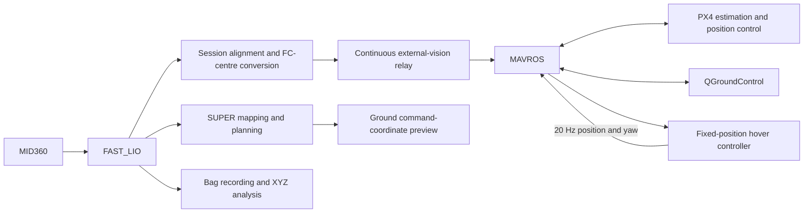

# Demo_HKU_open-day_SUPER

An indoor autonomous flight project for the HKU Open Day demonstration, integrating Livox MID360, FAST_LIO, SUPER, MAVROS, and PX4.

**Status — October 17, 2026:** the canonical mission now performs **five consecutive 4.5 m out-and-back rounds**, followed by one six-second hover and landing. Ground rehearsal requests 0.5 m height; physical tests retain 1.5 m. Per-round reports and ordered completion checks are implemented. Long cloud ROS trials stopped on stale virtual pose feedback, so a complete five-round ROS/onboard pass remains unverified. See [the current progress](docs/PROGRESS_2026-10-17.md).

**Status — October 16, 2026:** the complete demonstration supervisor and automatic test entrypoint are implemented: 1.5 m physical takeoff target (0.5 m for ground rehearsal), 4.5 m outbound, return, six-second hover and confirmed landing. The full synthetic ROS lifecycle and an injected return-failure test have passed. The new ground workflow captures the actual scene and runs real SUPER with virtual vehicle feedback in an isolated domain; the first onboard attempt passed preparation but failed backup planning for the 4.5 m route in a location subsequently reported to have approximately 1.5 m forward room. A separate 1 m rehearsal is available; the subsequent 1 m real-SUPER/virtual-vehicle sequence has been reported complete, with detailed report archival pending. Physical full-mission flight remains unverified. See [the complete mission test](docs/DEMONSTRATION_MISSION.md).

**Status — October 15, 2026:** the session-relative map correction has passed an aircraft ground audit. The controller accepted 217 matched references and retained `AUDIT_END` without faults across 18 status reports. Concurrent 30-second sampling found fresh raw, aligned, native-vision and FC poses; native-vision maximum age/gap was 35/36 ms. All remote preparation checks passed. RC/manual POSCTL remain required for supervised flight; this result does not validate airborne SUPER tracking or the 2 m/s demonstration. See [the recorded audit](data/observed_2026-10-15/session_map_ground_audit.json).

The automatic ground runner subsequently completed the full aircraft workflow with `RESULT: SUCCESS`: fresh quaternion capture/application, session-map creation, one audit and saved report. It accepted 217 references with no controller fault. See [the automatic run](data/observed_2026-10-15/automatic_ground_success.json); long-term localization stability and supervised flight remain unverified.

**Status — October 14, 2026:** the aircraft has completed OFFBOARD entry, automatic arming, takeoff, a hover test configured for 1 m above the floor with a 6-second hold, and automatic landing. Repeated hover tests are complete; approximately 10 cm lateral motion remains a tuning/estimation diagnostic item. The 50 Hz localization/vision chain and low-speed advertised-motion checks have passed ground samples. A disarmed 1 m vertical reference test progressed through `TRACK` to `END_HOLD`, accepting 684 samples and holding forward/left/FC-floor-height `[-0.0226, -0.0447, 1.0395] m` while suppressing subsequent restart references. These locked-frame endpoint offsets are within 10 cm per axis. A later 120-second stationary observation with online IMU–LiDAR extrinsic estimation disabled measured maximum forward/left/up coordinate excursions below 2 cm in both external and FC poses. A follow-up vertical reference trial in that fixed-extrinsic session latched a continuity fault after 409 accepted samples; detailed transition diagnostics are prepared before flight integration. See the [vertical reference result](data/observed_2026-10-13/vertical_goal_ground.json), [stationary observation](data/observed_2026-10-13/fastlio_stationary_diagnosis.json) and [integration progress](docs/PROGRESS_2026-10-13.md). Native SUPER trajectory flight, airborne tracking accuracy and obstacle avoidance remain the next integration stage. The cause of earlier stationary attitude/position inconsistencies and stability over a complete demonstration remain under investigation.

## Quick Start: after power-on or reboot

Connect to the onboard Ubuntu desktop, keep the aircraft stationary and disarmed on its takeoff floor, and open **one terminal**. With the matching scripts already installed, run:

```bash
python3 ~/Downloads/super_demo_test.py \
  --restart --fixed-lio-extrinsics --fixture-geometry \
  --motion-policy observe
```

The runner sources ROS itself, opens or reuses QGroundControl, starts the managed stack, captures and applies this run's quaternion, prepares the session map, waits for a continuous fresh 30-second real vision window and rehearses the complete **0.5 m virtual climb → five rounds of 4.5 m outbound and return → six-second hover → landing** with real SUPER and virtual vehicle feedback. On a desktop, RViz2 opens automatically after the private-domain isolation check and closes when the rehearsal ends. It shows point clouds, planning trajectories and the virtual vehicle body-heading arrow. The actual aircraft remains disarmed. The physical-flight mission retains a 1.5 m height; the 0.5 m rehearsal uses a separate per-run configuration. No manual quaternion copying, numbered terminals or separate goal request is needed. A normal reboot requires no reinstall or rebuild. Use `--no-rviz` for a run without the viewer; missing desktop or RViz is recorded as a skipped viewer.

Wait for `RESULT: SUCCESS` or `RESULT: FAIL` and the printed `REPORT:` path under `~/Downloads/super_demo_tests/<timestamp>/`. A rehearsal success covers every stage in the virtual mission; physical full-mission flight remains unverified. Fixture geometry is synthetic. Motion targets are 2 m/s and 1 m/s²; observation mode records exceedances with 2.4 m/s and 1.5 m/s² warning advisories while retaining position, freshness and continuity checks.

The complete mission has no deadline for the first verified trajectory of either navigation leg. During planning it holds the leg's starting hover point and prints `WAIT_PLAN` progress. There is no total execution deadline or per-trajectory duration cap; arrival of a valid trajectory resumes the route, and feedback determines stage completion. A failed planner process, invalid trajectory, stale feedback or operator stop still ends the run. After takeoff, positional rejection uses the configured outer venue and vehicle envelope. SUPER may follow curved obstacle-avoiding routes; the former 10 cm straight-line corridor and tracking-error abort are removed. Arrival checks still identify the requested hover points. QGC remains open when the test and managed stack stop.

After the test finishes, inspect or stop the background stack:

```bash
python3 ~/Downloads/super_session.py status
# After landing and disarming:
python3 ~/Downloads/super_session.py stop
```

Closing the terminal does not stop the managed tmux processes. Run the same complete-test command for another fresh session. For a separate short-site rehearsal, append `--route-profile short-1m`; use the default 4.5 m route in a suitable laboratory.

See **[the reboot startup guide](docs/REBOOT_QUICK_START.md)** for the pinned installer, saved-result inspection, measured mission configuration and separate supervised physical-flight startup. Physical execution requires surveyed geometry, current RC/manual POSCTL and compatible PX4 readbacks, followed by an explicit start request. The latest cloud stress run stopped on a timer gap; onboard recurrence remains to be checked.

Individual tools remain documented separately: [compact tmux startup and diagnosis](docs/SESSION_STARTUP.md), [the historical 1 m hover workflow](docs/FIRST_HOVER_2026-10-09.md), [the automatic one-goal ground audit](docs/AUTOMATED_GROUND_TEST.md), and [the complete demonstration specification](docs/DEMONSTRATION_MISSION.md).

## Project progress

| Component | Status | Result |
| --- | --- | --- |
| MID360 → FAST_LIO | Operational | Approximately 50 Hz odometry/vision in current samples; 17–23 ms scans in the recorded timing excerpt |
| Localization timing | Fixed and deployed | IMU Best Effort subscription removed the observed backlog; recent ground pose ages were approximately 20–35 ms |
| FAST_LIO → PX4 external vision | Operational | Position, height, and yaw fusion through MAVROS; fresh `vehicle_visual_odometry` and valid local position/velocity |
| Fixed-position flight | **Successful on aircraft** | Complete automatic takeoff, hover, and landing sequence |
| SUPER mapping and planning | Ground integration complete | Occupancy map, trajectory generation, replanning, and converted command preview |
| SUPER → PX4 ground transport | Verified on aircraft | Approximately 20 Hz native position/yaw publication and fresh PX4 position-control intent while disarmed |
| SUPER → flight trajectory execution | Prototype under validation | Aircraft ground audit held AUDIT_END beyond six seconds with fresh concurrent sampling; airborne handover pending |
| Remote operation | Operational | Mac → NoMachine → onboard Ubuntu desktop, including QGC and terminals |
| Loop recording and XYZ analysis | Tools ready | Bag export, point-cloud inspection, timing gaps, and return-to-marker metrics |
| Venue limits and 2 m/s demonstration | Pending | Surveyed boundaries, clearance margins, and staged flight validation |

The successful flight is a functional milestone. Height error, horizontal drift, timing distributions, and repeatability will be quantified from flight logs and independent measurements in the next test campaign.

- [Current integration progress and validation scope](docs/PROGRESS_2026-10-16.md)
- [Complete flight workflow: terminals 1–11 and reboot recovery](docs/FIRST_HOVER_2026-10-09.md)
- [Next development and validation steps](docs/NEXT_STEPS.md)
- [Three-terminal bag recording and XYZ analysis](docs/BAG_XYZ_2026-10-09.md)
- [Remote desktop and AX900 recovery](docs/REMOTE_RECOVERY_2026-10-09.md)

## System architecture



The onboard computer runs the complete ROS stack and connects to the flight controller over USB. Remote desktop access uses Wi-Fi; the USB link stays onboard during flight. QGC receives the MAVROS UDP forwarding stream rather than opening the flight-controller serial port directly.

The hover controller currently uses 10 Hz localization and sends 20 Hz position/yaw setpoints. Increasing sensor frequency is a separate optimization; duplicate samples and rewritten timestamps are not used to simulate a higher measurement rate.

## Repository structure

```text
scripts/
  localization/   Pose conversion, alignment, and external-vision relays
  flight/         Hover control, references, and parameter helpers
  planning/       SUPER command preview and diagnostic goals
  analysis/       Bag export and message-timing diagnostics
  maintenance/    Source patches, generators, and deployment helper
  layout.json     Source-to-aircraft filename mapping
docs/             Runbooks, progress, and historical checkpoints
configs/          Recorded configuration snapshots
patches/          FAST_LIO source patches
system/           AX900 startup configuration
tests/            Offline and isolated ROS checks
data/             Data storage conventions
```

Three complete standalone files remain at the root for stable download URLs: `first_hover_terminal.py`, `odom_age_check.py`, and `update_preview_alignment.py`.

The [script index](scripts/README.md) explains the categories and deployment rules. The [documentation index](docs/README.md) links the operational runbooks and historical checkpoints.

## Aircraft deployment

The aircraft uses Ubuntu 22.04, ROS2 Humble, and zsh. Livox, FAST_LIO, SUPER, and MAVROS workspaces must already be installed; this repository contains integration scripts and records rather than a complete bundled ROS distribution.

From the repository root on the onboard computer:

```bash
python3 scripts/maintenance/install_scripts.py
```

This installs missing scripts into `~/Downloads` and preserves existing files, including the active session alignment. To update changed files, first land, disarm, and stop affected processes, then use:

```bash
python3 scripts/maintenance/install_scripts.py --overwrite
```

Changed files are backed up before replacement. Localization or alignment updates require a fresh stationary pairing before restoring the vision relay. The deployment helper does not start nodes or change PX4 parameters.

Aircraft commands retain the flat `~/Downloads/script_name.py` paths even though repository sources are categorized. The standalone hover controller can also be downloaded separately using the [flight runbook](docs/FIRST_HOVER_2026-10-09.md#download-and-install).

## Configuration and coordinate conventions

| Parameter | Recorded test configuration |
| --- | --- |
| `EKF2_EV_CTRL` | `11`: horizontal position, height, and yaw; no external velocity |
| `EKF2_HGT_REF` | `3`: vision height reference |
| `EKF2_BARO_CTRL` | `1` |
| `EKF2_EV_DELAY` | `0.0` |
| `EKF2_EV_POS_X/Y/Z` | `0.0`: incoming poses already refer to the FC centre |
| `EKF2_EV_QMIN` | `0` |
| `MPC_XY_VEL_ALL`, `MPC_Z_VEL_ALL` | `-1.0` |
| `MPC_XY_VEL_MAX` | `0.5 m/s` |
| `MPC_Z_VEL_MAX_UP`, `MPC_Z_VEL_MAX_DN` | `0.5 m/s` |
| `COM_OF_LOSS_T` | `0.5 s` |
| `COM_OBL_RC_ACT` | `4`: Land in the recorded firmware |

FAST_LIO publishes `camera_init → body` at the LIO IMU origin. Conversion applies the nominal mounting rotation, lever arm, session world rotation, and fixed translation origin to produce FC-centre ENU poses. MAVROS handles ENU/NED conversion.

The nominal LiDAR mounting has approximately +45° yaw relative to the aircraft and a 10 cm vertical offset above the FC. The recorded internal IMU–LiDAR configuration uses `extrinsic_T=[-0.011,-0.02329,0.04412]` and identity rotation. A paired world quaternion is a session alignment, not an independent mechanical extrinsic calibration.

SUPER's `world` coordinates currently follow the numerical LIO world. The ground command preview converts these into the aligned FC frame. Trajectory flags `1` and `2` represent regular and backup trajectories in the pinned publisher; ground preview success does not implement trajectory flight.

## Development checks

Pure repository checks run from the checkout. ROS graph tests require Humble, MAVROS message/service definitions, and SUPER `PositionCommand`; use an environment and ROS domain isolated from the aircraft.

```bash
source /opt/ros/humble/setup.bash
export PYTHONPATH="$PWD:$PWD/scripts/localization:$PWD/scripts/flight:$PWD/scripts/planning:$PWD/scripts/analysis:$PWD/scripts/maintenance${PYTHONPATH:+:$PYTHONPATH}"
export ROS_DOMAIN_ID=180
export ROS_LOCALHOST_ONLY=1
python3 tests/test_repository_layout.py
python3 tests/test_super_session.py
python3 tests/test_super_motion_profiles.py
python3 tests/test_super_3d_goal_profile.py
python3 tests/test_ground_height_goal.py
python3 tests/test_bounded_reference.py
python3 tests/test_super_exact_start.py
python3 tests/test_control_chain_metrics.py
python3 tests/test_control_chain_metrics_ros.py
python3 tests/test_hover_reference.py
python3 tests/test_bag_to_xyz.py
python3 scripts/maintenance/build_first_hover_terminal.py --check
python3 tests/test_aligned_pose_preview.py
python3 tests/test_control_bridge_preview.py
python3 tests/test_flight_pose_cov_transport.py
python3 tests/test_first_hover_control.py
FIRST_HOVER_TEST_MODULE=first_hover_terminal python3 tests/test_first_hover_control.py
```

The deployment, reference, bag-export, motion-profile, height-goal, session-lifecycle, control-chain metric, bounded-reference and exact-start patch suites contain 58 unit tests. Separate 3D-goal generation, session-profile checks and bounded-reference checks passed for this update; the bounded-reference ROS fixture also passed; earlier motion-profile, control-chain metric, reference and bag-export results are recorded separately in the progress report. Real tmux dummy-node and isolated ROS parameter-service checks also passed for the compact manager. Isolated ROS checks cover pose/covariance conversion, planning preview, continuous vision forwarding, and one-shot hover control. The generated standalone controller matches the canonical implementation. Physical takeoff/hover/landing success is recorded separately from these software checks.

## Versions and references

| Component | Recorded version |
| --- | --- |
| Ubuntu / ROS | 22.04 / Humble |
| Livox driver | `livox_ros_driver2` 1.2.7 |
| FAST_LIO | ROS2, `a4743b095409588842a5b30ddfa27e29d2f99164` |
| SUPER | `2ad3419c127a617c6d7df6925e81a14175a9c096` |
| MAVROS | 2.14.0 |
| PX4 | HKUST_NXT_DUAL, 1.17.0, `d6f12ad1c4f70ad3230afd7d86e971421e02fef4` |

[SUPER](https://github.com/hku-mars/SUPER) · [FAST_LIO ROS2](https://github.com/hku-mars/FAST_LIO/tree/ROS2) · [Livox ROS Driver 2](https://github.com/Livox-SDK/livox_ros_driver2) · [MAVROS](https://github.com/mavlink/mavros/tree/2.14.0) · [PX4 external position estimation](https://docs.px4.io/main/en/ros/external_position_estimation) · [PX4 Offboard](https://docs.px4.io/main/en/flight_modes/offboard)
