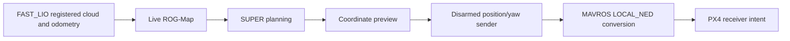

# October 14 integration

The current focus is the complete mapping, planning and FC transport path during remote disarmed operation. Further drift tuning is deferred. The fixed-extrinsic localization session remains active; its previous 120-second stationary observation measured less than 2 cm excursion per axis. The separate automatic 1 m hover/6-second hold/landing milestone remains complete.

## Managed native ground transport

The session manager now supports `wire-test` and `wire-stop`, reusing the existing ground position/yaw transport. It requires managed localization/vision, SUPER and the coordinate preview, one diagnostic target source and no other native control publisher before launch. The helper confirms MAVROS LOCAL_NED configuration and sends ENU position/yaw at 20 Hz only while connected/disarmed in AUTO.LOITER or POSCTL. Arming or OFFBOARD latches output off. No mode or arming service is requested.

A short +0.30 m same-height planner-X goal supplies diagnostic targets. The native path is `/planning/pos_cmd` → `/super_debug/control_target` → `/mavros/setpoint_position/local` → MAVROS/PX4. This checks protocol delivery while disarmed. The bounded preview's earlier continuity fault remains a reference-validation issue; it is not converted into flight approval by this transport test.

`wire-stop` stops only the sender. `planner-stop` stops it before the planner/reference processes, preserving localization and vision. Hover launch excludes the sender. Logs are stored in the active session directory as `wire_test.log`; no extra interactive terminal is required.

Twenty-seven lifecycle checks passed, including guarded launch, delayed publisher discovery, duplicate/source/controller rejection, workspace initialization for wire commands, preservation of localization, native-sender shutdown order and hover exclusion. A separate live ROS discovery fixture accepted a deliberately delayed publisher after 1.159 seconds with the sender launch mocked. The existing isolated ROS transport fixture also passed native 20 Hz delivery, ENU/yaw handling, stamp preservation, stale/invalid input rejection, duplicate writer/frame/service-loss blocking and permanent arming/OFFBOARD latches. These are software results; actual aircraft publication is recorded separately below.

### Aircraft native publication verified

After the ground-floor adjustment and deployment of manager revision `475b98a55672c03384e5a26227ba99d9a2ba5316`, the managed sender launched and a same-height planner-X goal was issued at `[0.328813, -0.036567, -0.451635] m`. The native `/mavros/setpoint_position/local` readback reported rolling rates of 19.993–20.001 Hz with observed receive intervals of 47–53 ms. The sender log transitioned from waiting for inputs to repeated `SENT ENU` output. This verifies the aircraft-side SUPER command → coordinate preview → native MAVROS position/yaw topic path. The initial topic-discovery warning was followed by actual message-rate measurements.

PX4 receiver readback is now verified. `listener offboard_control_mode 1` returned timestamp `162152863276 us`, age `0.029639 s`, and `position: True`; velocity, acceleration, attitude, body-rate, thrust/torque and direct-actuator intent were false. Together with the native publication measurements, this completes the disarmed SUPER → coordinate conversion → MAVROS → PX4 position/yaw transport milestone. The readback confirms receiver intent, not active OFFBOARD flight or tracking accuracy. Airborne handover, reference continuity, terminal hold, loss/takeover handling and a surveyed flight envelope remain the flight integration stage. Preserve the earlier faults below as diagnostic history rather than interpreting a launched process or retained old log as evidence of current output.

## Aircraft integration blocker: effective corridor floor

The aircraft sender launched in the rebooted `20261014_154445_304844` session, but emitted no setpoints. Its LOCAL_NED confirmation passed; it then waited for fresh local pose and debug target. The coordinate preview reported ready geometry while waiting for `/planning/pos_cmd`. SUPER repeatedly failed corridor decomposition with a seed at `[0.050, -0.050, -0.450] m` and a bounding-box minimum Z of `-0.400 m`. The seed was outside the corridor. PX4's `offboard_control_mode` remained never published. No aircraft-side transport success is claimed.

The installed profile reported configured virtual ground `-1.0 m`, 0.1 m map resolution, 0.2 m inflation resolution and 0.2 m robot radius. At pinned SUPER revision `2ad3419c127a617c6d7df6925e81a14175a9c096`, corner-grid initialization moves the configured virtual ground inward by the inflation steps and half a cell, then quantizes it again in ProbMap. With two inflation steps, the effective ground becomes `-0.600 m`; corridor construction adds the robot radius, producing the observed `-0.400 m` minimum. A standalone C++ arithmetic reproduction matched that boundary and the seed exclusion.

A ground-only configuration adjustment has been applied and read back on the aircraft: virtual ground is now `-1.5 m` in the existing 3D diagnostic profile, with its original file preserved. The same arithmetic yields effective ground `-1.100 m` and corridor minimum `-0.900 m`, which includes the observed seed. An isolated configuration-edit check verified that only this scalar changes and the original backup survives repeated execution. No planner-source patch, rebuild, robot-radius reduction, obstacle-inflation reduction, control limit or bounded-reference tolerance change is required. This excludes one known synthetic-boundary conflict; actual obstacle conflicts and localization stability remain separate. The first retest stopped at sender discovery before publishing a goal; the later updated-manager retest produced the native publication result above. The override is a planner-frame diagnostic value, not a surveyed physical floor or flight envelope. See the [reversible ground procedure](SESSION_STARTUP.md#ground-corridor-floor-conflict).

The first retest reported `Need one SUPER coordinate-preview source` immediately after starting planning. A subsequent explicit graph readback found exactly one `control_bridge_preview` publisher and zero subscribers; all managed localization/vision/planning processes remained active and no wire window existed. The original sender log remained on disk from the stopped attempt. The manager now waits up to 12 seconds when no preview publisher is discovered, rejects multiple publishers immediately with their count, and continues to reject other native writers before launch. Both wire commands also source the standard workspace setup files like the other ROS actions. No setpoint freshness checks, controller requests or sender behavior changed. Updated-manager deployment, actual native publication and PX4 receiver intent have since been verified.

Earlier same-day sessions also lost fresh odometry or developed large stationary coordinate changes, despite active processes. The fixed-extrinsic startup flag and an earlier successful 120-second observation do not establish stability across restarts. Preserve the original failure logs; do not infer a permanent localization correction from reboot recovery. Structured observations are archived in [the ground-wire blocker record](../data/observed_2026-10-14/ground_wire_blocker.json).

## Reference diagnostics and map workflow

### One-goal flight-interface prototype

A separate `super_flight_control.py` prototype now reuses the existing hover lifecycle through extension hooks, preserving the original hover services and default behavior. Default operation is a grounded, disarmed audit: capture fixed geometry/forward/floor, request one 0.30 m forward goal at the captured height, match regular commands to committed polynomials, reject discontinuities and hold a verified endpoint. It emits debug targets and status only. Managed `handover-check` stops a managed wire sender if present, preserves localization/planning and starts that default mode; `handover-stop` stops only the auditor.

The experimental execution path requires an explicit start and RC/POSCTL readiness, rises to 1 m, holds for two seconds, requests one forward SUPER goal, follows verified references, holds the terminal point for six seconds and requests LAND. Estimated tracking and reference/endpoint offsets are limited to 10 cm per axis; actual estimated position must also remain inside the initial straight-line corridor. Source/configuration changes, loss, unacceptable motion and timer interruption latch a stop; pilot mode takeover is not overwritten. The first stage retains the reserved 0.25/0.45 planner, existing PX4 caps and 20 Hz position/yaw output.

The original hover ROS regression passed. Nine isolated new scenarios and numerical geometry/corridor checks passed, together with 30 manager lifecycle and three layout checks. One test run triggered the retained 0.2-second timer watchdog and correctly requested LAND; representative mixed-rate reruns passed without relaxing the guard. Status reports callback runtime and timer-gap maxima for onboard inspection. These fixtures use simulated telemetry/services, not PX4 flight dynamics. The aircraft ground auditor has since reached `AUDIT_END`; planner-driven flight and complete-session stability remain pending. See the [handover runbook](SUPER_HANDOVER.md).

Prepared reference-fault diagnostics distinguish source-stamp gaps from converted position steps and retain previous/current references, polynomial timing and terminal evidence. Ten numerical checks and the existing isolated three-case ROS fixture passed. Rejection thresholds and endpoint-hold requirements are unchanged. This instrumentation is available for later control-interface work; the current step does not resume localization tuning or require its deployment to inspect transport.

The current ROG-Map profile builds a live map from registered cloud and odometry, with saved-PCD loading disabled. Confirm a nonempty occupancy map before planning. Prebuilt maps must later be registered to the active localization frame; saved-map loading, relocalization and native planner-driven flight are not implemented by the ground sender. See the [compact workflow](SESSION_STARTUP.md#managed-disarmed-transport-test).

## Aircraft one-goal ground audit reaches the terminal reference

After the command-to-polynomial matching correction, the grounded checker reached `READY`, accepted one forward goal, entered `AUDIT_TRACK` and then `AUDIT_END` with 218 accepted references. The held forward/left/FC-floor-height was `[0.3172, 0.0106, 0.0941] m`, within the prototype corridor. This completes one terminal-reference ground audit; the aircraft remained disarmed and the auditor emitted debug output only.

A local-pose freshness fault latched `STOPPED` approximately 0.68 s after the terminal transition. The six-second stable-hold requirement for the experimental flight lifecycle is not established by this short ground hold. A later separate 30-second sample found all four sampled topics fresh, with single publishers, valid increasing stamps and expected frames. Local-pose maximum receive gap/header age were 45/19 ms; raw odometry maxima were 39/30 ms. The original fault subtype and cause remain unestablished, and the provided MAVROS log tail predates the fault. Retain the current freshness limits; do not infer a permanently corrected transport or clock from the later healthy sample. See [the structured audit record](../data/observed_2026-10-14/super_handover_audit.json).

## Sustained endpoint ground audit

The subsequent default auditor trial accepted 217 matched references and reached `AUDIT_END`, retaining `[0.2967, 0.0055, 0.1052] m` in captured forward/left/FC-floor-height coordinates for 18 consecutive status reports in the 20-second display window. The ground endpoint remained fixed beyond six seconds with no observed fault. The concurrent 30-second sample recorded raw odometry/command/coordinate-preview/local-pose maximum receive gaps of 43/24/27/44 ms and maximum header ages of 32/16/18/22 ms. Each topic had one publisher, valid increasing stamps and expected frames. This advances the ground handover milestone to sustained terminal hold; it does not establish aircraft trajectory flight or the cause of the earlier isolated freshness fault.

Remote preparation continues without RC/pilot supervision. A new read-only `flight-check` manager action reports software prerequisites, including configuration, fresh FC/external agreement, RC/manual mode and competing native writers, without starting/stopping nodes or emitting control requests. Thirty-two lifecycle tests and three isolated ROS readiness cases passed; mock mode/arming/parameter-write/goal/native counters remained zero. The next physical stage is supervised 1 m takeoff, a short low-speed 0.30 m forward handover, six-second endpoint hold and landing, retaining the existing 10 cm limits before expanding toward the 2 m/s candidate.

## Remote software prerequisites pass on the aircraft

The read-only readiness action has now been exercised on the aircraft. All remote preparation checks passed: typed parameter configuration, LOCAL_NED, fresh valid localization, FC/vision agreement, single localization sources, active managed processes, the reserved 3D planner profile and absence of native writers. Observed position/yaw separation was 7.124 mm/0.011451°. No errors were reported. The aircraft remained disarmed in AUTO.LOITER with manual input false; RC had zero fresh channels, despite one advertised RC publisher.

The only remaining sampled-input blockers were manual POSCTL and fresh RC data. Remote preparation is complete for this snapshot. The next physical milestone is on-site supervised low-speed handover flight; complete-flight stability, independent tracking accuracy, PX4 preflight and surveyed clearance remain separate validations. Preserve the existing parameter and freshness limits. The [readiness snapshot](../data/observed_2026-10-14/remote_flight_readiness.json) records the exact results.

## Repeated ground hold with concurrent native-vision sampling

A later session completed the one-goal ground audit with 217 accepted references and 18 consecutive fault-free `AUDIT_END` reports in a 20-second observation window. The held forward/left/FC-floor-height reference was `[0.3462, -0.0154, 0.0757] m`. Concurrent 30-second raw/aligned/native-vision/FC-pose sampling passed freshness checks; native vision maximum header age/receive gap were 47/51 ms. Existing margins and freshness thresholds were preserved. The [new audit record](../data/observed_2026-10-14/super_handover_vision_audit.json) retains the exact sampled metrics separately from earlier trials.

Before this successful repetition, generic native-vision freshness faults stopped one audit after 86 accepted references and another readiness session before goal acceptance. Diagnostics now distinguish controller receive age from ROS header age, and the independent sampler observes native vision directly. The successful concurrent window does not establish the cause of those intermittent faults. No planner-driven aircraft flight or 2 m/s test was performed; on-site RC supervision remains required for the next physical stage.

## Visual relay exact-stamp queue correction

A real-DDS regression exposed a relay defect under brief callback bursts: independent depth-one raw/aligned readers discard different timestamps, starving the exact-stamp join while upstream messages remain fresh. The original configuration produced no output for 1.162 seconds. Bounded depth-16 readers produced 52 unchanged pairs in the same test, with a 60 ms maximum output gap, and rejected stale queued measurements. Original 250 ms/-50 ms age limits and source/geometry/parameter/covariance gates remain unchanged. The full relay protection regression also passed.

The manager adds explicit grounded `vision-restart` for loading the fix without replacing the current alignment or restarting the core/planner. Thirty-four manager lifecycle tests passed, including unsafe-state, writer-conflict and stale-preview rejection. A real-tmux fixture with dummy processes confirmed that only the vision process ID changes, the core/preview/planner process IDs and alignment file remain intact, and shutdown leaves no dummy nodes behind. Aircraft confirmation remains pending; the reproduced defect is not established as the cause of the earlier generic aircraft faults. See [the repair and recovery workflow](SUPER_HANDOVER.md#exact-stamp-vision-pairing-under-callback-bursts) and [software validation record](../data/software_checks_2026-10-14/vision_pair_queue.json).

## Repeated ground preparation and parameter-response recovery

The first aircraft relay-restart attempt was blocked before shutdown by a source-count check that did not wait for DDS discovery. That check now waits for zero counts within the existing 12-second discovery budget, rejects duplicates immediately and reports per-topic counts. A later attempt timed out awaiting fusion parameters. An independent request returned all six expected values, and MAVROS recorded a failed response transmission to the client. The manager now reuses its parameter client for up to three read-only requests within the original 12-second response budget. Writes and force-pulls are not replayed; late cancelled responses cannot supply accepted values.

Five live-DDS service cases under 50 Hz telemetry passed: healthy read, first-response delay recovery, exhausted-read rejection, single write transmission and arming rejection during a wait. The existing ground-service regression and 35 manager unit tests passed. Three real-tmux lifecycle runs preserved unrelated process IDs and geometry, then shut down without dummy-node leaks. Three isolated ROS audit runs each retained a fixed terminal reference for 6.2 seconds with no nominal fault before deliberate arming-fault injection verified permanent shutdown. These are software fixtures, not complete aircraft startups or PX4 dynamics runs; see [the structured validation](../data/software_checks_2026-10-14/repeated_ground_preparation.json). A fresh aircraft session and repeated physical ground audits remain necessary to confirm deployment stability. Actual sensor/FC loss and invalid parameters still correctly prevent readiness or stop the controller.
