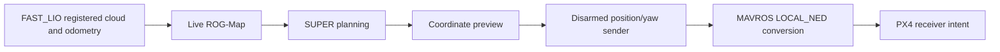

# October 14 integration

The current focus is the complete mapping, planning and FC transport path during remote disarmed operation. Further drift tuning is deferred. The fixed-extrinsic localization session remains active; its previous 120-second stationary observation measured less than 2 cm excursion per axis. The separate automatic 1 m hover/6-second hold/landing milestone remains complete.

## Managed native ground transport

The session manager now supports `wire-test` and `wire-stop`, reusing the existing ground position/yaw transport. It requires managed localization/vision, SUPER and the coordinate preview, one diagnostic target source and no other native control publisher before launch. The helper confirms MAVROS LOCAL_NED configuration and sends ENU position/yaw at 20 Hz only while connected/disarmed in AUTO.LOITER or POSCTL. Arming or OFFBOARD latches output off. No mode or arming service is requested.

A short +0.30 m same-height planner-X goal supplies diagnostic targets. The native path is `/planning/pos_cmd` → `/super_debug/control_target` → `/mavros/setpoint_position/local` → MAVROS/PX4. This checks protocol delivery while disarmed. The bounded preview's earlier continuity fault remains a reference-validation issue; it is not converted into flight approval by this transport test.

`wire-stop` stops only the sender. `planner-stop` stops it before the planner/reference processes, preserving localization and vision. Hover launch excludes the sender. Logs are stored in the active session directory as `wire_test.log`; no extra interactive terminal is required.

Twenty-five lifecycle checks passed, including guarded launch, duplicate/source/controller rejection, preservation of localization, native-sender shutdown order and hover exclusion. The existing isolated ROS transport fixture also passed native 20 Hz delivery, ENU/yaw handling, stamp preservation, stale/invalid input rejection, duplicate writer/frame/service-loss blocking and permanent arming/OFFBOARD latches. These are software results. Aircraft-side managed sender output and receiver intent still require readback.

## Aircraft integration blocker: effective corridor floor

The aircraft sender launched in the rebooted `20261014_154445_304844` session, but emitted no setpoints. Its LOCAL_NED confirmation passed; it then waited for fresh local pose and debug target. The coordinate preview reported ready geometry while waiting for `/planning/pos_cmd`. SUPER repeatedly failed corridor decomposition with a seed at `[0.050, -0.050, -0.450] m` and a bounding-box minimum Z of `-0.400 m`. The seed was outside the corridor. PX4's `offboard_control_mode` remained never published. No aircraft-side transport success is claimed.

The installed profile reported configured virtual ground `-1.0 m`, 0.1 m map resolution, 0.2 m inflation resolution and 0.2 m robot radius. At pinned SUPER revision `2ad3419c127a617c6d7df6925e81a14175a9c096`, corner-grid initialization moves the configured virtual ground inward by the inflation steps and half a cell, then quantizes it again in ProbMap. With two inflation steps, the effective ground becomes `-0.600 m`; corridor construction adds the robot radius, producing the observed `-0.400 m` minimum. A standalone C++ arithmetic reproduction matched that boundary and the seed exclusion.

A ground-only configuration adjustment is prepared: change virtual ground to `-1.5 m` in the existing 3D diagnostic profile, preserving its original file. The same arithmetic yields effective ground `-1.100 m` and corridor minimum `-0.900 m`, which includes the observed seed. An isolated configuration-edit check verified that only this scalar changes and the original backup survives repeated execution. No source patch, rebuild, robot-radius reduction, obstacle-inflation reduction, control limit or bounded-reference tolerance change is required. This excludes one known synthetic-boundary conflict; actual obstacle conflicts and localization stability remain separate. Aircraft retest is pending. The override is a planner-frame diagnostic value, not a surveyed physical floor or flight envelope. See the [reversible ground procedure](SESSION_STARTUP.md#ground-corridor-floor-conflict).

Earlier same-day sessions also lost fresh odometry or developed large stationary coordinate changes, despite active processes. The fixed-extrinsic startup flag and an earlier successful 120-second observation do not establish stability across restarts. Preserve the original failure logs; do not infer a permanent localization correction from reboot recovery. Structured observations are archived in [the ground-wire blocker record](../data/observed_2026-10-14/ground_wire_blocker.json).

## Reference diagnostics and map workflow

Prepared reference-fault diagnostics distinguish source-stamp gaps from converted position steps and retain previous/current references, polynomial timing and terminal evidence. Ten numerical checks and the existing isolated three-case ROS fixture passed. Rejection thresholds and endpoint-hold requirements are unchanged. This instrumentation is available for later control-interface work; the current step does not resume localization tuning or require its deployment to inspect transport.

The current ROG-Map profile builds a live map from registered cloud and odometry, with saved-PCD loading disabled. Confirm a nonempty occupancy map before planning. Prebuilt maps must later be registered to the active localization frame; saved-map loading, relocalization and native planner-driven flight are not implemented by the ground sender. See the [compact workflow](SESSION_STARTUP.md#managed-disarmed-transport-test).
