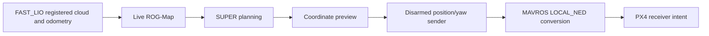

# October 14 integration

The current focus is the complete mapping, planning and FC transport path during remote disarmed operation. Further drift tuning is deferred. The fixed-extrinsic localization session remains active; its previous 120-second stationary observation measured less than 2 cm excursion per axis. The separate automatic 1 m hover/6-second hold/landing milestone remains complete.

## Managed native ground transport

The session manager now supports `wire-test` and `wire-stop`, reusing the existing ground position/yaw transport. It requires managed localization/vision, SUPER and the coordinate preview, one diagnostic target source and no other native control publisher before launch. The helper confirms MAVROS LOCAL_NED configuration and sends ENU position/yaw at 20 Hz only while connected/disarmed in AUTO.LOITER or POSCTL. Arming or OFFBOARD latches output off. No mode or arming service is requested.

A short +0.30 m same-height planner-X goal supplies diagnostic targets. The native path is `/planning/pos_cmd` → `/super_debug/control_target` → `/mavros/setpoint_position/local` → MAVROS/PX4. This checks protocol delivery while disarmed. The bounded preview's earlier continuity fault remains a reference-validation issue; it is not converted into flight approval by this transport test.

`wire-stop` stops only the sender. `planner-stop` stops it before the planner/reference processes, preserving localization and vision. Hover launch excludes the sender. Logs are stored in the active session directory as `wire_test.log`; no extra interactive terminal is required.

Twenty-five lifecycle checks passed, including guarded launch, duplicate/source/controller rejection, preservation of localization, native-sender shutdown order and hover exclusion. The existing isolated ROS transport fixture also passed native 20 Hz delivery, ENU/yaw handling, stamp preservation, stale/invalid input rejection, duplicate writer/frame/service-loss blocking and permanent arming/OFFBOARD latches. These are software results. Aircraft-side managed sender output and receiver intent still require readback.

## Reference diagnostics and map workflow

Prepared reference-fault diagnostics distinguish source-stamp gaps from converted position steps and retain previous/current references, polynomial timing and terminal evidence. Ten numerical checks and the existing isolated three-case ROS fixture passed. Rejection thresholds and endpoint-hold requirements are unchanged. This instrumentation is available for later control-interface work; the current step does not resume localization tuning or require its deployment to inspect transport.

The current ROG-Map profile builds a live map from registered cloud and odometry, with saved-PCD loading disabled. Confirm a nonempty occupancy map before planning. Prebuilt maps must later be registered to the active localization frame; saved-map loading, relocalization and native planner-driven flight are not implemented by the ground sender. See the [compact workflow](SESSION_STARTUP.md#managed-disarmed-transport-test).
